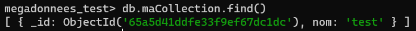
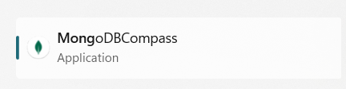
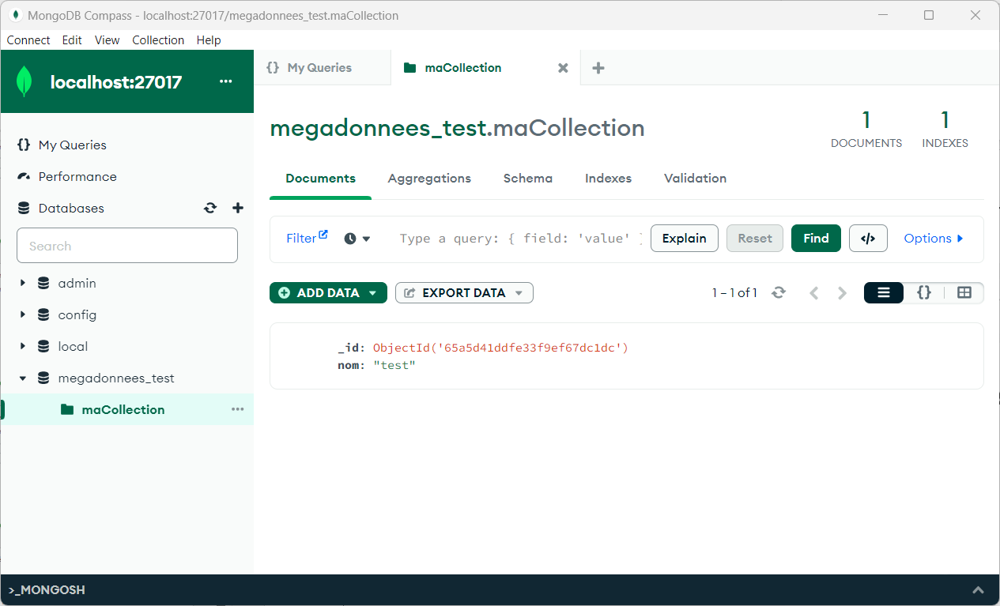

# Installation logicielle

## 1. MongoDB Community Server 8.2

- Disponible à même devilbox
    - Utiliser ma version de devilbox pour avoir le MongoDB le plus récent
    - Ce devilbox va être utilisé pour Services Web aussi

```bash
cd ~
git clone https://github.com/SebastienTrottierCEGEP/devilbox.git
cd devilbox
cp env-example .env
docker compose up -d
```

- Vérifier dans Docker Desktop que le conteneur `devilbox/mongo-1` est bien lancé
- La base de données est créée dans un volume séparé du conteneur dans Docker et rendue disponible à MongoDB via le répertoire `/data/db`. Donc la base de données va survivre à un `docker compose down` ou `rm`

## 2. Compass

- GUI pour interagir avec la base des données
    - <https://www.mongodb.com/try/download/compass>
- Nouvelle connexion : `localhost:27017` sans usager ni mot de passe

## 3. mongosh (MongoDB Shell)

- Installé avec l’image MongoDB

    ```bash
    docker exec -it devilbox-mongo-1 mongosh
    ```

- Ou dans Docker Desktop :
    - clic sur le conteneur
    - onglet *Exec*
    - `mongosh`
- Aussi disponible via un bouton dans Compass
- Autres versions (macOS, Linux) : <https://www.mongodb.com/try/download/shell>

## 4. MongoDB Command Line Database Tools

- Documentation : <https://www.mongodb.com/docs/database-tools/>
    - `mongoimport` / `mongoexport`
    - `mongodump` / `mongorestore`
- Disponible dans l’image MongoDB

    ```bash
    docker exec -it devilbox-mongo-1 bash
    ```

- Ou dans Docker Desktop :
    - clic sur le conteneur
    - onglet *Exec*
- Autres versions (macOS, Linux) : <https://www.mongodb.com/try/download/database-tools>

## Vérification du fonctionnement de l’environnement MongoDB

### Avec mongosh

1. Exécutez la commande `mongosh`
2. Exécutez les commandes suivantes :

    ```javascript
    use megadonnees_test
    db.maCollection.insertOne({nom:"test"})
    db.maCollection.find()
    ```

3. Comparez le résultat à celui-ci (la valeur de `ObjectId` sera différente) :

    

### Avec MongoDB Compass

1. Ouvrez le logiciel MongoDB Compass
2. Conservez l’URL `mongodb://localhost:27017` et appuyez sur *Connect*
    - Cliquez sur la BD `megadonnees_test`
    - Cliquez sur la collection `maCollection`
    - Confirmez la présence d’un enregistrement créé




