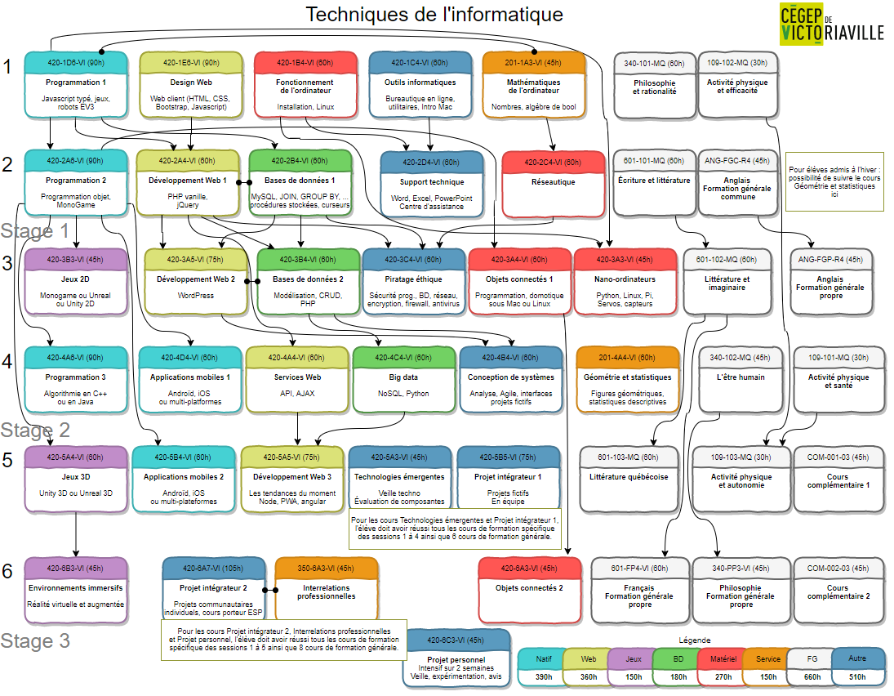

## Présentation du cours

**Titre :** Mégadonnées

**Question :** Que croyez-vous que nous ferons dans ce cours cet hiver?

## Contenu

- Tel que son nom l’indique, le cours sera centré sur l’**acquisition**, le **traitement** et l’**analyse** de données massives.
- Au début de la session, vous apprendrez les concepts entourant divers types de bases de données. Vous serez en mesure d’identifier les principales différentes entre ceux-ci et dans quels contextes seront utilisés.
- Par la suite, deux SGBD NoSQL seront approfondis : MongoDB et Neo4j.
- Dans les 3-4 dernières semaines de la session, vous devrez réaliser un projet permettant de répondre à un besoin réel de traitement et d’analyse de données massive.

## Planification

| Semaine | Contenu |
|---|---|
| **Semaine 1** | Présentation du cours Initiation à MongoDB Introduction aux mégadonnées |
| **Semaine 2** | MongoDB : Requêtes de lecture, d’insertion, de modification et de suppression de données |
| **Semaine 3** | MongoDB : Limites, tri et regroupement |
| **Semaine 4** | MongoDB : Conception, création, importation et génération de données Évaluation formative formelle |
| **Semaine 5** | MongoDB : Sécurité, cohérence et performances |
| **Semaine 6** (avant la relâche) | Révision MongoDB Examen #1 : MongoDB |
| **Semaine 7** | Théorie sur les graphes Introduction à Neo4j |
| **Semaine 8** | Neo4j : Requêtes de lecture, d’insertion, de modification et de suppression de données |
| **Semaine 9** | Neo4J : Limites, tri et regroupement |
| **Semaine 10** | Neo4J : Contextes d'utilisation |
| **Semaine 11** | Examen #2 : Neo4j Démarrage du projet |
| **Semaine 12** | Mégadonnées: approfondissement (GraphQL, Redis, Hadoop, Apache Spark, Hive, Power BI, etc.) |
| **Semaine 13 à 15** | Projet |

## Évaluations en cours de session

| Évaluation | Pondération | Échéancier |
|---|---|---|
| Évaluation formative formelle | 0% | Semaine 4 |
| Examen MongoDB | 25% | Semaine 6 |
| Examen sur les graphes | 25% | Semaine 10-11 |
| Épreuve finale | 50% | Semaines 11-15 |

**Épreuve finale :**

- Projet individuel
- Conception et organisation de données massives dans le but de répondre à un besoin fictif.
