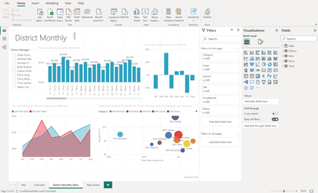

# Business Intelligence et sciences des données

## Business Intelligence (BI)

### Qu'est-ce que la BI?

- La BI (Business Intelligence / intelligence d'affaires) transforme des données en information utile à la décision.
- Elle sert à suivre la performance, les tendances et les KPI (indicateurs clés de performance).
- Elle s'appuie surtout sur des données structurées, consolidées et historisées.
- Ses livrables typiques sont les rapports et tableaux de bord.
- Technologies : Power BI, Tableau, SQL, OLAP (Online Analytical Processing / traitement analytique en ligne), entrepôts de données.

### Architecture décisionnelle

- Sources : ERP (Enterprise Resource Planning), CRM (Customer Relationship Management), web, capteurs, bases SQL et NoSQL.
- Intégration : extraction, nettoyage, transformation et normalisation.
- Stockage : data lake (lac de données), data warehouse (entrepôt de données), data mart (magasin de données ou mini-entrepôt thématique).
- Consommation : rapports, tableaux de bord et analyses ad hoc.
- Technologies : Talend, SSIS, Airbyte, Snowflake, BigQuery.

### Data lake, warehouse et mart : termes et définitions

| Terme anglais | Terme français | Explication |
|---|---|---|
| Data lake | Lac de données | Réservoir de données brutes, variées et massives, conservées avant transformation détaillée. |
| Data warehouse | Entrepôt de données | Base intégrée, structurée et historisée conçue pour l'analyse décisionnelle. |
| Data mart | Magasin de données / mini-entrepôt thématique | Sous-ensemble ciblé sur un domaine métier précis, dérivé de l'entrepôt ou alimenté séparément. |

En pratique, on garde souvent les termes anglais dans les outils, mais on enseigne fréquemment les équivalents français en contexte académique.

### ETL, ELT et entrepôt de données

- ETL (Extract, Transform, Load) : extraire, transformer, charger les données dans l'entrepôt.
- ELT (Extract, Load, Transform) : charger d'abord, transformer ensuite dans la plateforme cible.
- L'entrepôt centralise les données; le data mart cible un besoin métier.
- Ces approches rendent les indicateurs plus fiables et les requêtes plus rapides.
- Technologies : dbt, Airflow, SQL Server, Redshift, Hive.

### Visualisation et tableaux de bord

- Un bon tableau de bord affiche peu d'indicateurs, mais les bons.
- Il montre rapidement les écarts, tendances et alertes.
- Les filtres facilitent l'analyse par période, segment ou région.
- Les visuels doivent soutenir un objectif d'affaires précis.
- Technologies : Power BI, Tableau, Qlik Sense, Looker Studio.

### Technologies principales de la BI

- Collecte et intégration : Talend, SSIS, Airbyte, Fivetran.
- Stockage décisionnel : SQL Server, Oracle, Snowflake, Redshift, BigQuery.
- Analyse multidimensionnelle : SSAS, Apache Kylin, Mondrian.
- Visualisation : Power BI, Tableau, Qlik Sense, Looker Studio.
- Ces outils servent surtout à suivre et expliquer l'activité.

## Sciences des données

### Qu'est-ce que la science des données?

- Elle combine statistiques, programmation et expertise métier.
- Elle sert à expliquer, prédire ou recommander une action.
- Elle peut exploiter des données structurées, semi-structurées ou non structurées.
- Elle cherche des modèles utiles dans des volumes importants de données.
- Technologies : Python, R, notebooks, bibliothèques d'apprentissage automatique.

### Préparation des données et apprentissage automatique

- La préparation comprend le nettoyage, l'encodage et la normalisation des données.
- L'ingénierie des variables améliore la qualité des modèles.
- Le machine learning apprend des régularités à partir des données.
- Approches : supervisé, non supervisé, validation et métriques.
- Technologies : pandas, NumPy, PySpark, scikit-learn, TensorFlow.

### Cycle de vie d'un projet de science des données

1. Définir le problème d'affaires et le critère de succès.
2. Obtenir et comprendre les données.
3. Préparer les données et construire les variables.
4. Entraîner, tester et comparer les modèles.
5. Déployer, surveiller et ajuster la solution.

### Technologies principales de la science des données

- Exploration et préparation : Python, R, Jupyter, pandas, NumPy.
- Traitement massif : Spark, PySpark, Databricks, Hadoop.
- Apprentissage automatique : scikit-learn, TensorFlow, PyTorch, XGBoost.
- Déploiement et suivi : MLflow, FastAPI, Docker, Kubernetes.
- Ces outils servent surtout à prédire, segmenter et optimiser.

## Complémentarité entre BI et science des données

- La BI (Business Intelligence / intelligence d'affaires) décrit et diffuse l'état actuel de l'organisation.
- La science des données prédit, segmente et optimise.
- Les tableaux de bord peuvent intégrer les résultats de modèles prédictifs.
- Une même plateforme de données peut servir les deux usages.
- Exemple : BI pour suivre les ventes, data science pour prévoir la demande.

## Tableau comparatif : BI et sciences des données

| Aspect | Business Intelligence | Sciences des données |
|---|---|---|
| But principal | Suivre, expliquer et piloter | Prédire, optimiser et recommander |
| Données | Plutôt structurées et historisées | Structurées, semi-structurées ou non structurées |
| Méthodes | KPI (indicateurs clés de performance), reporting, OLAP (Online Analytical Processing / traitement analytique en ligne), tableaux de bord | Statistiques, apprentissage automatique, expérimentation |
| Résultats | Rapports, alertes, tableaux de bord | Modèles, scores, segments, recommandations |
| Technologies | Power BI, Tableau, SQL, Snowflake, SSAS | Python, pandas, Spark, scikit-learn, TensorFlow |

La BI (Business Intelligence / intelligence d'affaires) aide surtout à comprendre le présent; la science des données aide davantage à anticiper et agir.
