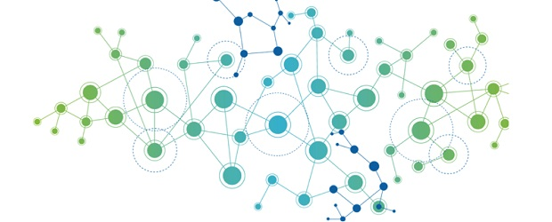

# Graphes – Conception

## Plan

- Conception d’une base de données orientée graphes
    - Définir le schéma
    - Contraintes
    - Sécurité
    - Nomenclature et recommandations
    - Importation
    - Optimisation
    - Modèles



## Définir le schéma

- Comme dans la majorité des SGBD NoSQL, le modèle semi-structuré permet de concevoir une base de données sans nécessairement fournir de schéma.
- Il est donc possible de créer une base de données vierge et débuter en créant des nœuds et des relations de types variés

### Exemple

```cypher
CREATE (matrix:Movie { title:"The Matrix",released:1997 })
CREATE (cloudAtlas:Movie { title:"Cloud Atlas",released:2012 })
CREATE (forrestGump:Movie { title:"Forrest Gump",released:1994 })

CREATE (keanu:Person { name:"Keanu Reeves"})
CREATE (robert:Person { name:"Robert Zemeckis", born:1951 })
CREATE (tom:Person { name:"Tom Hanks", born:1956 })

CREATE (tom)-[:ACTED_IN { roles: ["Forrest"]}]->(forrestGump)
CREATE (tom)-[:ACTED_IN { roles: ['Zachry']}]->(cloudAtlas)
CREATE (robert)-[:DIRECTED]->(forrestGump)

MATCH p=()-[]-() RETURN p
```

### Références

- <https://neo4j.com/docs/getting-started/current/cypher-intro/schema/>
- <https://neo4j.com/developer/guide-data-modeling/>
- <https://neo4j.com/developer/modeling-designs/>
- <https://neo4j.com/graphgists/>

## Contraintes

- Afin d’avoir un certain contrôle sur l’intégrité du modèle, il est possible d’ajouter des contraintes qui fixent certaines balises.
    - <https://neo4j.com/docs/cypher-manual/current/schema/syntax/#create-constraint>
- Certaines contraintes ne sont cependant disponibles que pour la version Neo4j Entreprise.
    - Le service infonuagique Aura utilise la version Enterprise
    - Ces contraintes peuvent aussi être rendues disponibles dans la version Community à l’aide du plug-in DozerDB (version 5.21.2)

- Contrainte d’unicité :

```cypher
CREATE CONSTRAINT nom_contrainte_1 FOR (n:NomEtiquette)
REQUIRE n.nomPropriete IS UNIQUE
```

- Contrainte de nœud – propriété requise (Enterprise) :

```cypher
CREATE CONSTRAINT nom_contrainte_2 FOR (n:NomEtiquette)
REQUIRE n.propertyName IS NOT NULL
```

- Contrainte relationnelle – propriété requise (Enterprise) :

```cypher
CREATE CONSTRAINT nom_contrainte_3 FOR
()-[R:RELATIONSHIP_TYPE]-()
REQUIRE R.propertyName IS NOT NULL
```

### Exemples

```cypher
CREATE CONSTRAINT nom_1 FOR (book:Book)
REQUIRE book.isbn IS UNIQUE

CREATE CONSTRAINT nom_2 IF NOT EXISTS FOR (book:Book)
REQUIRE book.isbn IS UNIQUE

CREATE CONSTRAINT nom_3 FOR ()-[like:LIKED]-()
REQUIRE like.day IS NOT NULL
// propriété requise - Enterprise

CREATE CONSTRAINT nom_4 FOR (n:Person)
REQUIRE (n.firstname, n.surname) IS NODE KEY
// propriétés doivent être définies et uniques ensemble - Enterprise

SHOW CONSTRAINTS
```

## Sécurité

- Il est possible de créer des usagers et définir les mots de passe (similaire à MySQL)

```cypher
CREATE USER nom_usager SET PASSWORD 'mot_de_passe' CHANGE NOT REQUIRED;
SHOW USERS;
```

- Avec la version Entreprise, il est également possible d’ajouter des rôles et d’en définir les permissions accordées et/ou interdites :
    - <https://neo4j.com/docs/cypher-manual/current/administration/security/>
        - <https://neo4j.com/docs/cypher-manual/current/administration/security/writes/>
        - <https://neo4j.com/docs/cypher-manual/current/administration/security/reads/>

- Des rôles prédéfinis sont aussi existants (Entreprise):
    - **Public** : exécution des procédures et fonctions définies
    - **Reader** : exécution de requêtes en lecture seule seulement (+ rôle public)
    - **Editor** : peut exécuter des requêtes en édition mais ne peut pas définir de nouvelles étiquettes, propriétés et types de relations (+ rôle reader)
    - **Publisher** : peut définir de nouvelles étiquettes, propriétés et types de relations (+ rôle editor)
    - **Architect** : peut définir des index et des contraintes (+ rôle publisher)
    - **Admin** : peut créer/détruire les bases de données, les rôles et permissions (+ rôle architect)

<https://neo4j.com/docs/cypher-manual/current/administration/security/built-in-roles/>

## Nomenclature et recommandations

Voici les recommandations de nomenclature provenant de la documentation officielle (<https://neo4j.com/docs/cypher-manual/current/syntax/naming/>)

- Les noms débutent par un caractère alphabétique, incluant les caractères accentués
    - *(`1first` n’est pas permis, alors que `first1` est permis)*
- L’utilisation de symboles, à l’exception de la barre de soulignement `_`, est interdite.
- L’utilisation du symbole `$` réfère à une variable.

- Les caractères d’espacement (whitespace) sont supprimés automatiquement dans une requête.
- Les noms sont sensibles à la casse
    - `:PERSON`, `:Person` et `:person` seront considérées comme 3 étiquettes différentes
- (La longueur d’un nom n’est pas un problème - jusqu’à 65 534 caractères)

- Il est possible d’utiliser les mêmes noms d’étiquettes, propriétés et types.

```cypher
CREATE (n:a {a: 'val1'})-[r:a]-()
```

- Utiliser la convention CamelCase pour les **étiquettes de noms** :

```cypher
:VehicleOwner
```

- Utiliser la convention UPPER\_CASE et une barre de soulignement pour **les types de relations**

```cypher
:OWNS_VEHICLE
```

- Puisqu’ils font partie intégrante des recommandations dans la documentation officielle, ***vous devez appliquer ces standards de nomenclature dans vos exercices, projets et examens***.

## Importation

- Malgré sa structure particulière, il demeure possible d’importer des données à partir d’un fichier CSV
- La clause `LOAD CSV` vous permet d’accomplir cette tâche.
    - <https://neo4j.com/docs/cypher-manual/current/clauses/load-csv/>
- Neo4j Desktop fournit aussi cette fonctionnalité
- Dans la majorité des cas, il sera cependant nécessaire d’appliquer d’autres requêtes pour compléter votre modèle, principalement pour relier vos données entre elles.

## Exercice

- Créez une nouvelle base de données
- Voici les commandes pour importer les 3 fichiers CSV à partir de GitHub :

```cypher
LOAD CSV WITH HEADERS FROM "https://raw.githubusercontent.com/Megadonnees/Echantillons/main/persons.csv" AS csvLine
CREATE (p:Person {id: toInteger(csvLine.id), name: csvLine.name});

LOAD CSV WITH HEADERS FROM "https://raw.githubusercontent.com/Megadonnees/Echantillons/main/movies.csv" AS csvLine
MERGE (country:Country {name: csvLine.country})
CREATE (movie:Movie {id: toInteger(csvLine.id), title: csvLine.title, year:toInteger(csvLine.year)})
CREATE (movie)-[:ORIGIN]->(country);

LOAD CSV WITH HEADERS FROM "https://raw.githubusercontent.com/Megadonnees/Echantillons/main/roles.csv" AS csvLine
MATCH (person:Person {id: toInteger(csvLine.personId)}), (movie:Movie {id: toInteger(csvLine.movieId)})
CREATE (person)-[:ACTED_IN {role: csvLine.role}]->(movie);
```


- Inspectez le graphe résultant
- Ajoutez une contrainte pour s’assurer que les titres de films soient uniques
- Ajoutez une contrainte pour s’assurer que le rôle soit indiqué pour toutes les relations de type `ACTED_IN` (fonctionnalité Neo4j Entreprise)
- Ajoutez une contrainte pour s’assurer que la combinaison du titre et de l’année de sortie de chaque film soit unique (fonctionnalité Neo4j Entreprise)
- Testez vos contraintes en tentant d’insérer des nœuds/relation qui sont en violation de ces contraintes
