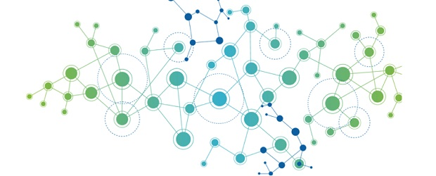
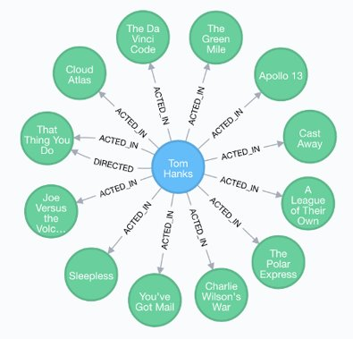
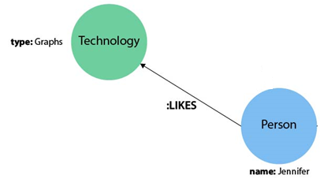
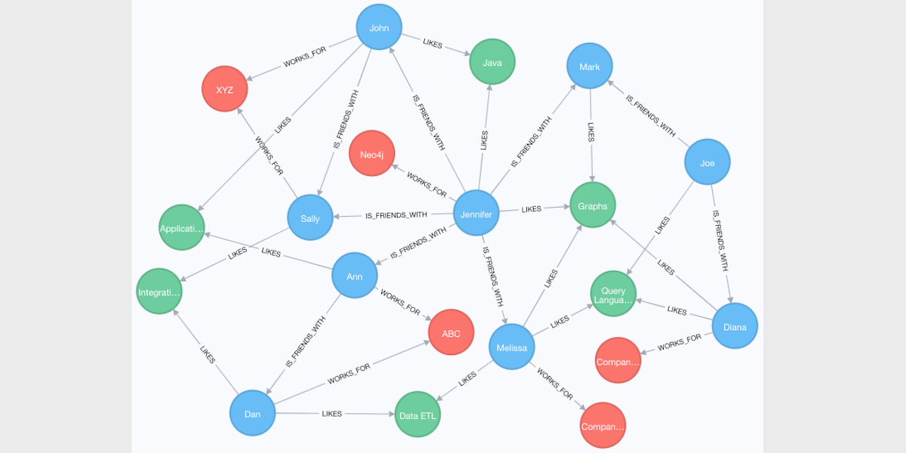
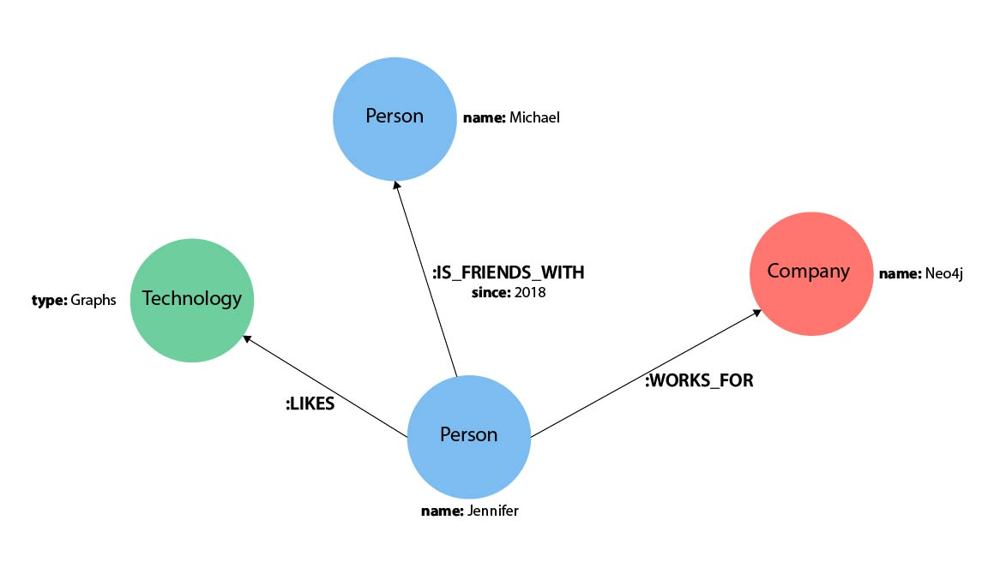
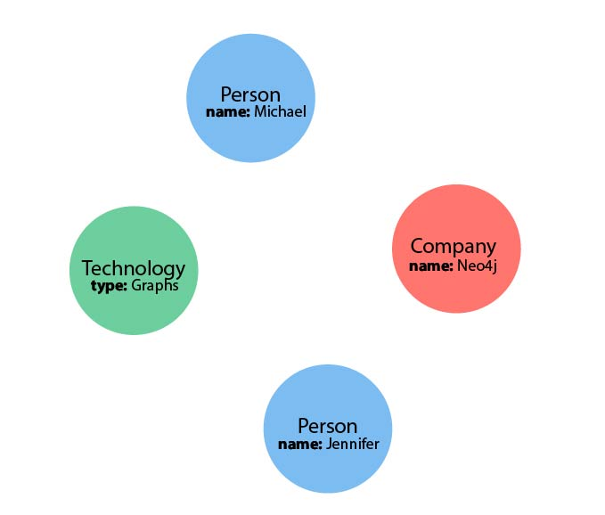
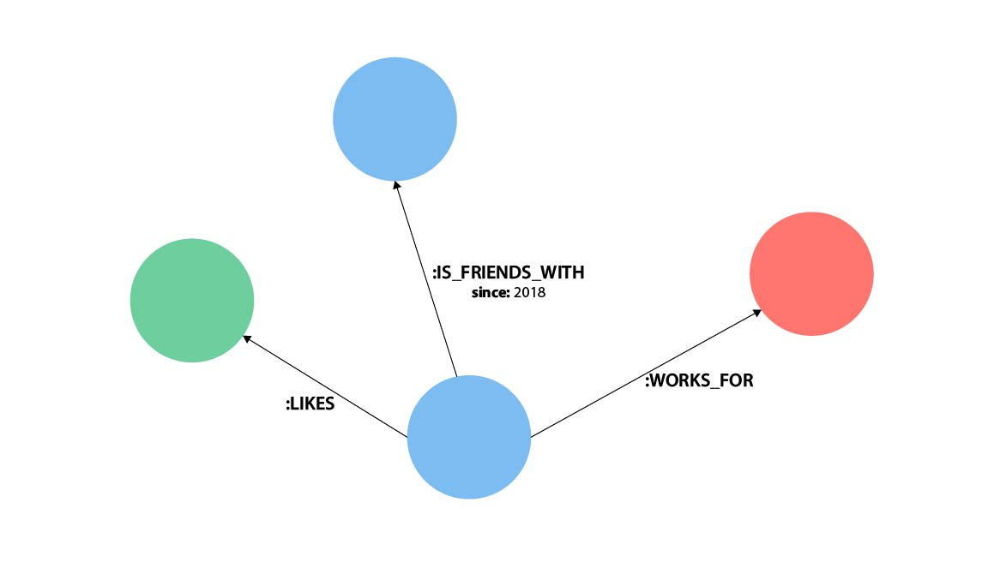
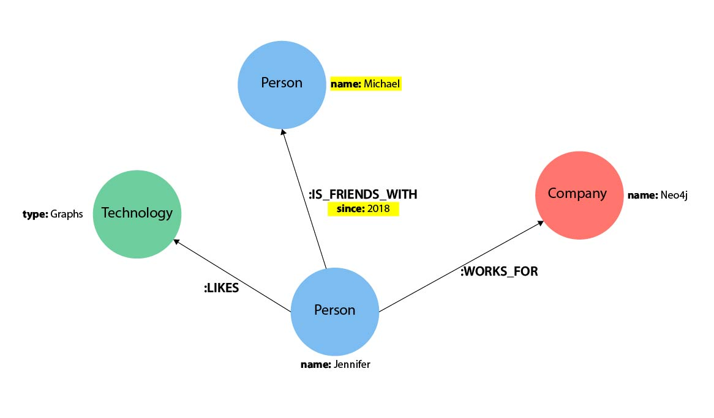
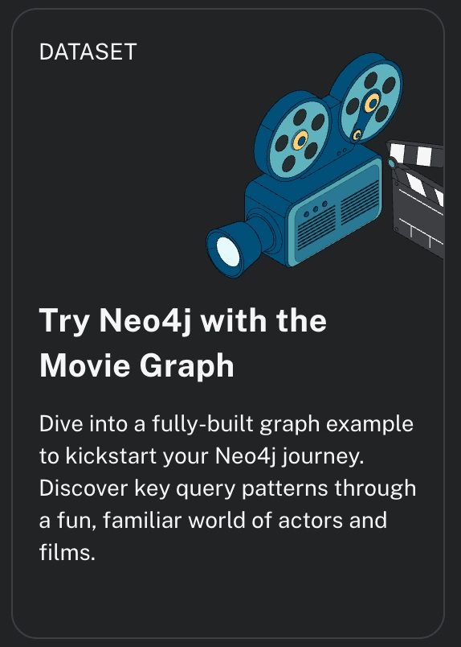

# Introduction aux graphes

## Plan

- Forces et les faiblesses du modèle relationnel
- Principes d’une base de données orientée graphes
- Forces et les faiblesses d’une base de données orientée graphes
- Introduction à Neo4j 
- Cypher - La syntaxe



## Forces et les faiblesses du modèle relationnel

- Forces
    - Simple
    - Structuré
    - Intégrité des données
- Faiblesses
    - Rigide
        - non adapté aux enregistrements hétérogènes, ayant des attributs variables
    - Accès par jointure
        - opération lourde et coûteuse

## Bases de données orientées graphe : définition

- Les bases de données orientées graphe correspond à un modèle conçu pour stocker et rechercher des relations.
- Les ***relations*** (arcs/arêtes orientées) sont des citoyens de première classe dans les bases de données orientées graphe, et **la majeure partie de la valeur de ces bases de données est issue de ces relations**.



- Les bases de données orientées graphe recourent à des ***nœuds*** (sommets) pour stocker les entités de données, ainsi qu'à des ***arcs*** (flèches/arêtes orientées) pour stocker les relations entre les entités.
- Un **arc** possède toujours
    - un nœud de départ
    - un nœud de fin
    - un type
    - une direction.



- Un **arc** peut décrire les relations, actions, possession parent-enfant, etc.
    - (*edge* - arête en anglais - parfois traduit comme *périphérie*)
- Le nombre et le type de relations qu'un nœud peut avoir **sont illimités**.

### Parcours du graphe

- Un graphe contenu dans une base de données orientée graphe peut être traversé le long de types d'arcs spécifiques ou à travers le graphe tout entier.
- Dans les bases de données orientées graphe, traverser des relations se fait très rapidement, car les relations entre les nœuds ne sont pas calculées au moment de la demande, mais sont maintenues dans la base de données.

- Les bases de données orientées graphe possèdent des avantages sur les bases de données relationnelles pour des cas d'utilisation tels que :
    - les réseaux sociaux
    - les moteurs de recommandation
    - la détection des fraudes
    - toute situation pour laquelle **il est nécessaire d'établir des relations** entre des données et d'interroger rapidement ces relations.
- Source : <https://aws.amazon.com/fr/nosql/graph/>

## Forces et faiblesses d’une BD orientée graphes

Forces

- Flexibilité
    - Structure semi-structurée.
    - Ajout, modification de nœuds, de relations et de propriétés sans perturber les requêtes existantes
- Performances
    - Requêtes de recherche très performantes, mêmes lorsque plusieurs relations sont impliquées
- Agilité
    - Évolution simple de la base de données en cohérence avec l’évolution des besoins
    - Relations bidirectionnelles possibles

Faiblesses

- Partitionnement et densité
    - dans un environnement distribué (plusieurs serveurs), il est difficile de segmenter le modèle pour une utilisation optimale
- Performances
    - Limitation lors des requêtes d’agrégation (par exemple, le regroupement) et des recherches par type

## Exemples de graphes

- Nœuds : Personne, Technologie, Compagnie
- Relations (verbes) : Est ami, Aime, Travaille pour



## Introduction à Neo4j

- Neo4j est un système de gestion de base de données (SGBD) basé sur les graphes, développé en Java par la société Neo Technology.
- Il permet :
    - De modéliser et stocker des données dans un graphe
    - D’effectuer des requêtes en fonction des nœuds et des relations.

## Neo4j: Installation

Installez Neo4J localement : [Procédure d'installation](../exercices/Installation_Neo4J.md)  

## Cypher : langage de requête pour Neo4j

- Le langage de requête utilisé par Neo4j s'appelle **Cypher**
- Les prochaines pages présentent quelques exemples de requêtes pouvant être effectuées. Ces exemples proviennent de l’introduction au langage : <https://neo4j.com/docs/getting-started/cypher/>
- La documentation officielle peut être consultée ici : <https://neo4j.com/docs/cypher-manual/current/>
- *Cheat Sheet* (commandes importantes en format compact) du langage Cypher : <https://neo4j.com/docs/cypher-cheat-sheet/>

## Soit le modèle suivant…



## Les nœuds

- Chaque nœud appartient à un type (*label*).
- Dans cet exemple, les types sont :
    - Person
    - Technology
    - Company
- Dans Cypher, les types (labels) sont référés avec un symbole `:` (deux points) comme préfixe
    - `:Person`



## Les relations

- Chaque relation est aussi associée à un type.
- Dans cet exemple, les types sont :
    - `LIKES`
    - `IS_FRIENDS_WITH`
    - `WORKS_FOR`
- Comme pour les nœuds, les types des relations sont référés dans Cypher avec un symbole `:` (deux points) comme préfixe
    - `:LIKES`



## Les propriétés

Des propriétés peuvent être associées aux nœuds et aux relations

Les propriétés peuvent différer d'un nœud à l'autre, même s'ils sont du même type. Même chose pour les relations.

Sur cet exemple :

- Chaque nœud `Person` a une propriété `name`
- Le nœud `Company` a une propriété `name`
- Le nœud `Technology` a une propriété `type`
- La relation `IS_FRIENDS_WITH` a une propriété `since`



## Les modèles (patterns)

La base de données est structurée à partir de modèles (*patterns*).

Pour construire un modèle, il faut associer deux nœuds avec une relation.

Le pattern « Jennifer LIKES Graphs » sera représenté ainsi :

```cypher
(:Person {name: "Jennifer"})-[:LIKES]->(:Technology {type: "Graphs"})
```


## Cypher – Les requêtes

- Nœuds
    - Entre parenthèses
    - L'identifiant avant les deux points est une variable (optionnel)
    - Le type (*label*) suit les deux points
    - Les paramètres sont entre accolades

```cypher
(p:Person {name: 'Tom Hanks'})
```

- Relations
    - Entre crochets `[]`
    - L'identifiant avant les deux points est une variable (optionnel)
    - Le type suit les deux points (en majuscules selon la convention)
    - Les paramètres sont entre accolades

```cypher
[r:ACTED_IN {roles: ["Neo"]}]
```

- `MATCH`
    - Le mot-clé `MATCH` est utilisé pour rechercher le modèle qui y est décrit.
- `RETURN`
    - Le mot-clé `RETURN` permet de spécifier les éléments qui seront retournés par la requête
- `WHERE`
    - Ajoute des contraintes aux modèles dans une clause `MATCH` ou `OPTIONAL MATCH` ou filtre les résultats d'une clause `WITH`.

## Cypher – Les requêtes - exemples

```cypher
MATCH (p:Person)
RETURN p
```

```cypher
MATCH (p:Person)
RETURN p
LIMIT 1
```

```cypher
MATCH (tom:Person {name: 'Tom Hanks'})
RETURN tom
```

```cypher
MATCH (:Person {name: 'Tom Hanks'})-[:DIRECTED]->(movie:Movie)
RETURN movie
```

```cypher
MATCH (p:Person)-[:DIRECTED]->(m:Movie)
WHERE m.released > 2010
RETURN p,m
```

```cypher
MATCH (n)-[r]->(m)
RETURN *
LIMIT 10
```

```cypher
// Tout le contenu de la BD
MATCH (n)
OPTIONAL MATCH p = ()-[]->()
RETURN *
```

## Cypher – Les requêtes

- Il existe d’autres clauses que nous apprendrons dans les prochaines semaines. Parmi celles-ci :
    - `ORDER BY`
    - `SKIP`
    - `LIMIT`
    - `OPTIONAL MATCH`
    - `UNWIND`
    - `CREATE`
    - `DELETE`
    - `SET`
    - `REMOVE`
    - `MERGE`

## Exercice

- Installez le projet *Movies*
- Parcourez le tutoriel
    - S’ouvre à gauche l'ouverture du guide


