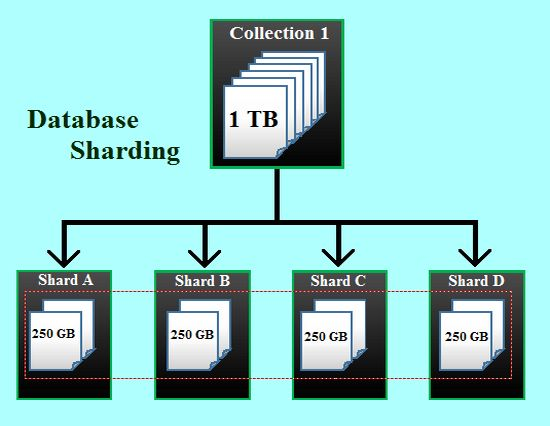
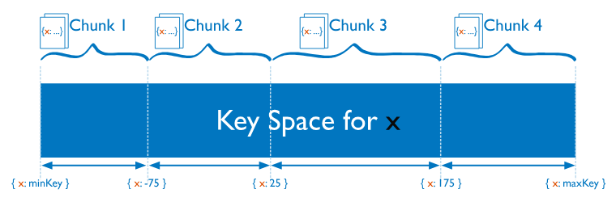
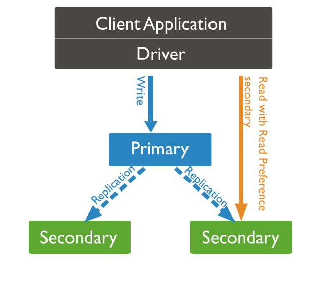
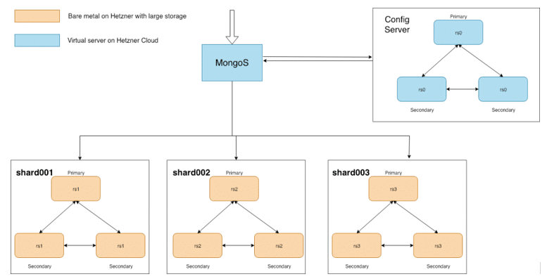
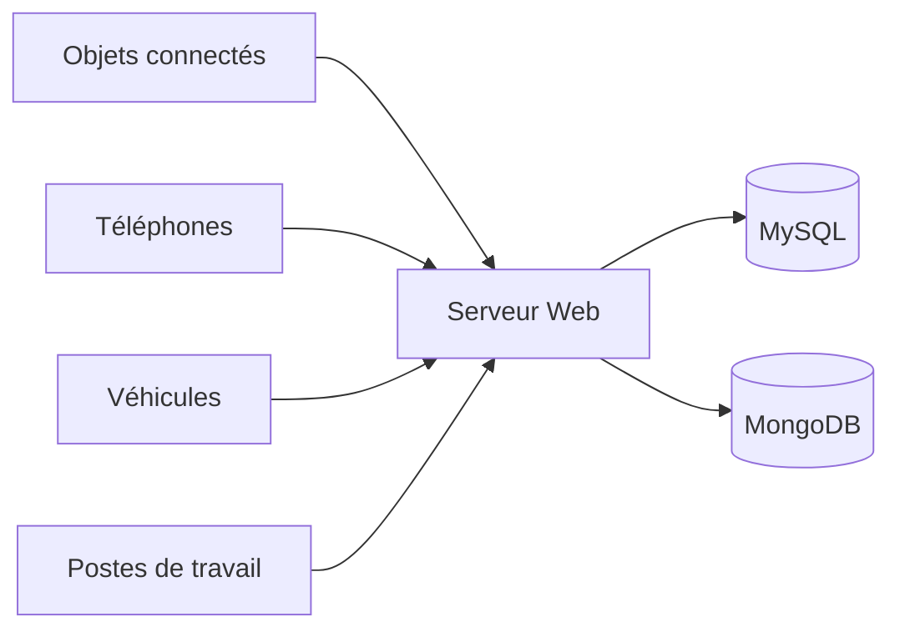
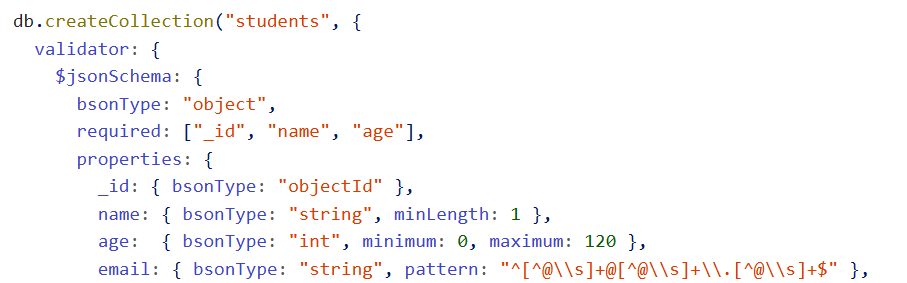
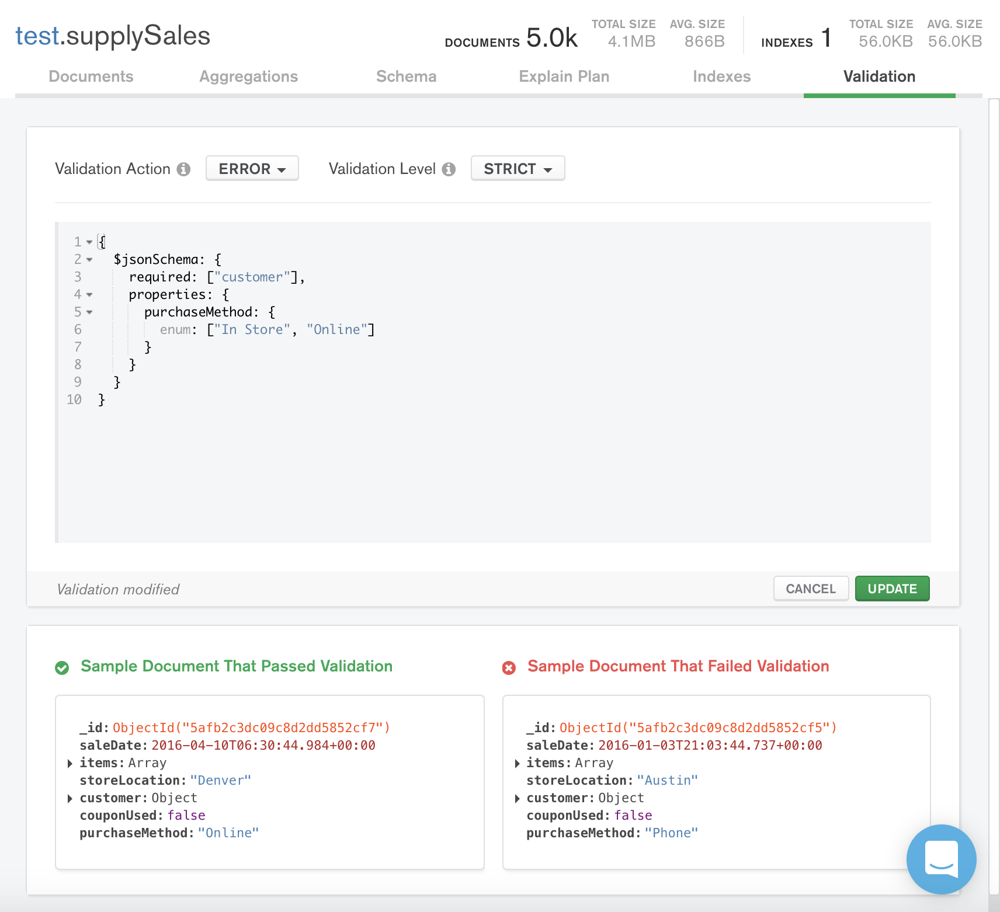

# MongoDB – Conception d'une base de données massive

## Sharding (partitionnement)

Le partitionnement (*sharding* en anglais) est une méthode fréquemment utilisée dans un contexte de données massives pour **répartir les données sur plusieurs serveurs**.

Un seul serveur ne suffit généralement pas à gérer toute l’information:

- Limite de stockage
- Capacité de traitement maximale



MongoDB offre des fonctionnalités de partitionnement intégrées permettant aux gestionnaires de bases de données de choisir comment les données seront réparties entre les différents serveurs.

On cherche à optimiser le traitement :

- Temps de recherche d’information **VS** Temps d’écriture

Liens utiles :

- <https://www.lebigdata.fr/sharding-definition-avantage>
- <https://docs.mongodb.com/manual/sharding/>
- <https://www.youtube.com/watch?v=4upppuW7lGE&t=1s>
- <https://docs.mongodb.com/manual/tutorial/deploy-shard-cluster/>
- <https://www.mysql.com/fr/products/cluster/scalability.html>

L'administrateur de bases de données a la responsabilité d'assurer que le partitionnement est fait de manière optimale.

C'est à lui que revient le rôle de déterminer la meilleure méthode pour partitionner le contenu. Cela se fait en identifiant les **clés de partitionnement** (**Shard Keys** : <https://docs.mongodb.com/manual/sharding/#shard-keys>).

Une clé de partitionnement (*Shard Key*) correspond aux champs qui sont utilisés pour fractionner les documents.

### Shard Key

Soit un champ indexé unique, soit plusieurs champs couverts par un index composite qui détermine la distribution des documents de la collection parmi les partitions (Shards).



### Shard Key Index

Les collections partitionnées en *shards* **doivent avoir un index** qui prend en charge le *Shard Key*.

L'index peut être sur le même champ que le *Shard Key* ou un index composite où le *Shard Key* est un préfixe de l'index.

## Réplication

La plupart des SGBD modernes offrent également des fonctionnalités permettant une réplication des données:

- Pour éviter les pertes d’information en cas de problème matériel ou erreur logicielle
- Permet d’accélérer les accès en lecture.

- <https://docs.mongodb.com/manual/replication/>
- <https://www.mongodb.com/basics/replication>
- <https://www.youtube.com/watch?v=5GOHTf1Tfw4>
- <https://dev.mysql.com/doc/refman/8.0/en/replication.html>



## Partitionnement et réplication

**Quelle est la différence entre le partitionnement (sharding) et la réplication ?**

**Partitionnement/Sharding** : gère la mise à l'échelle horizontale entre les serveurs, avec les documents distribués à l'aide d'une clé. Chaque serveur a une partie des données seulement.

**Réplication** : les données du serveur principal sont répliquées sur le serveur secondaire. Cela augmente la disponibilité des données et sert de sauvegarde en cas de défaillance du serveur principal.

**Les deux concepts peuvent être utilisés en même temps!**

<https://www.mongodb.com/basics/replication#difference-between-replication-and-sharding>

## Partitionnement et réplication en simultané

Source: <https://kruschecompany.com/mongodb-sharding-cluster-configuration/>



## Conception de base de données massives

- Tel que discuté au premier cours, chaque type de base de données a son utilité.
- Dans un contexte d’acquisition, de traitement et d’analyse de données massives, il est fréquent que les données soient organisées dans plusieurs SGBD en fonction de leurs forces et leurs faiblesses



L'objectif principal de MongoDB est d'offrir un SGBD permettant une flexibilité maximale. (<https://docs.mongodb.com/manual/core/data-modeling-introduction/>)

Dans la version initiale, aucune validation des données n'était intégrée au SGBD. La responsabilité revenait donc aux programmeurs d'assurer la validité des données soumises.

Ensuite sont apparus des outils permettant d'offrir des documents semi-structurés et un minimum de validation sous forme d'ODM *(Object Document Mapping)*

C’est une interface qui fait le lien entre les modèles d’une application et la base de données.

## Object Document Mapping (ODM)

L'ODM le plus répandu avec MongoDB est **Mongoose** (<https://mongoosejs.com/>), qui représente les données sous forme d'objets avec la plateforme **node.js**.

En PHP, c'est Doctrine qui est le plus utilisé : <https://www.doctrine-project.org/projects/doctrine-mongodb-odm/en/2.2/index.html>

## Règles de validation

Dans MongoDB, il est possible de définir à la création d'une collection les règles de bases qu'un document doit respecter :

- Types (BSON : <https://docs.mongodb.com/manual/reference/bson-types/>)
- Champs obligatoires
- Limites
    - nombre min/max
    - énumérations
    - longueur de texte
- Formats (expressions régulières)

## Règles de validation avec `$jsonSchema`

Références :

- <https://docs.mongodb.com/manual/core/schema-validation/>
- <https://docs.mongodb.com/manual/reference/operator/query/jsonSchema/#mongodb-query-op.-jsonSchema>
- <https://www.mongodb.com/blog/post/json-schema-validation--dependencies-you-can-depend-on>



## Insérer des règles de validation dans MongoDB Compass

- <https://www.mongodb.com/docs/compass/current/validation/>



## Exercice : conception de base de données massives

### Conception d’une base de données

- Sujet : Gestion de produits à caractéristiques diverses
- Idée : Trouvez 5 à 10 produits de différentes catégories (jeux vidéo, console, vêtements, articles divers, etc.)
- Prenez le temps d’établir :
    - Les caractéristiques communes
    - Les caractéristiques propres à chacun des produits
- Concevez le modèle et **ajoutez les validations nécessaires**

### Génération des données

- Créez un script permettant de générer au minimum 10 000 produits avec diverses caractéristiques.
    - Les produits doivent être catégorisés (selon vos préférences, vous pouvez associer une seule ou plusieurs catégories à un produit)
    - La quantité en stock, le prix coûtant et le prix de vente doivent être présents
    - Certains produits ne doivent plus être offerts
    - Les produits peuvent recevoir des avis (note de 0 à 5 et commentaire optionnel – lorem ipsum)

### Exemple de script

```javascript
use('MaBD');
db.reservations.deleteMany({});
var dateDepartReservation = new Date('2020-12-01');
var destinations = ['Sud', 'Europe', 'Asie', 'Grand Nord'];
printjson(destinations);
for(var i = 0; i < 10000; i++) {
    var reservation = {};
    dateDepartReservation.setMinutes(dateDepartReservation.getMinutes() + 5 );
    reservation.dateReservation = dateDepartReservation;
    reservation.destination = destinations[Math.floor(Math.random() * 4)];
    reservation.nombrePassagers = Math.floor(Math.random() * 7);
    reservation.prixTotal = Math.floor(Math.random() * 10) * 200 * reservation.nombrePassagers;
    //printjson(db.reservations.countDocuments());
    db.reservations.insertOne(reservation);
}
```

### Requêtes

Une fois que les données sont générées, réalisez les requêtes suivantes :

- Liste des produits non disponibles
- Liste des produits de plus de X$ de la catégorie de votre choix
- Liste des produits sans commentaires
- Liste des produits ayant plus de 10 commentaires
- Liste des produits ayant une caractéristique de votre choix (par exemple, la couleur bleue)
- Liste des produits ayant 2 caractéristiques de votre choix (Liste des jeux de guerre classés pour tous)
- Liste des produits n’ayant pas la caractéristique désirée
- Nombre de produits par catégorie
- Nombre de commentaires par produit
- Liste des 10 produits ayant les moyennes de notes de commentaires les plus basses
- Liste des produits ayant des commentaires écrits (pas juste une note)
- Prix moyen de tous les produits
- Prix moyen des produits par catégorie
- Prix moyen des produits selon la note des avis
- Produit le plus cher
- Produit le moins cher
- Liste des produits avec nom du produit, prix coutant, prix de vente et marge de profit (prix de vente – prix coûtant)
- Top 5 des produits ayant les plus grosses marges de profits
- Liste des produits ayant des marges de profits négatives (prix coûtant supérieur au prix de vente)
- Moyenne des marges de profits
- 3 requêtes de votre choix

### Optimisation

- Proposez des index en fonction des requêtes demandées ou des besoins anticipés (on présume que vos données seront utilisées dans une application de vente en ligne)
- Justifiez vos choix
