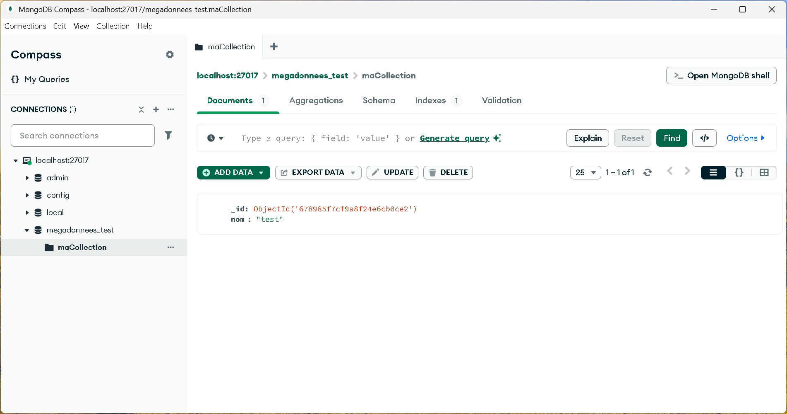
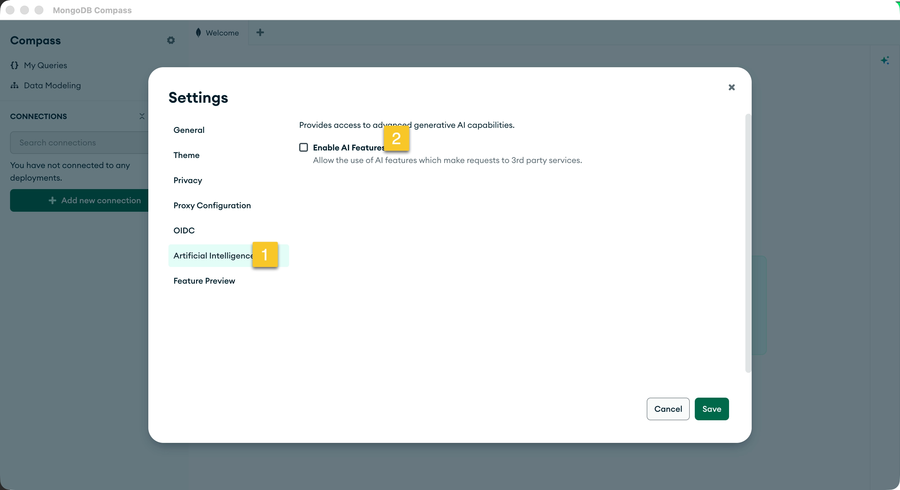
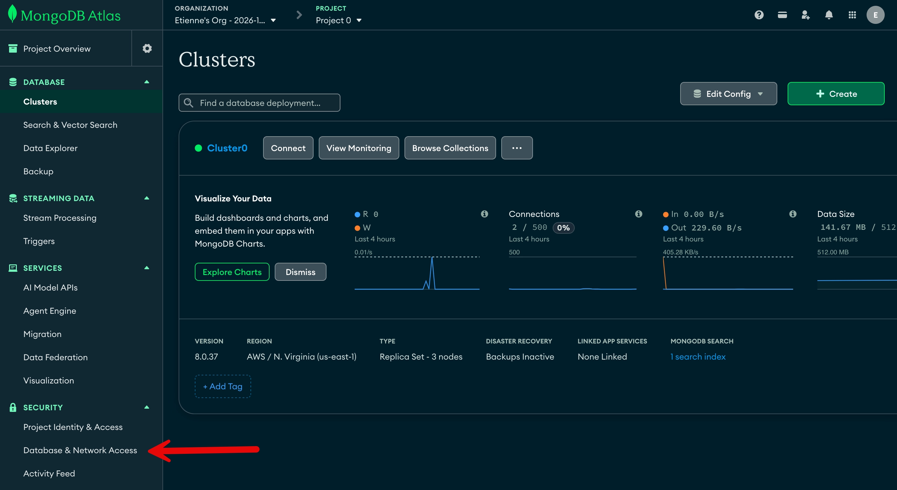
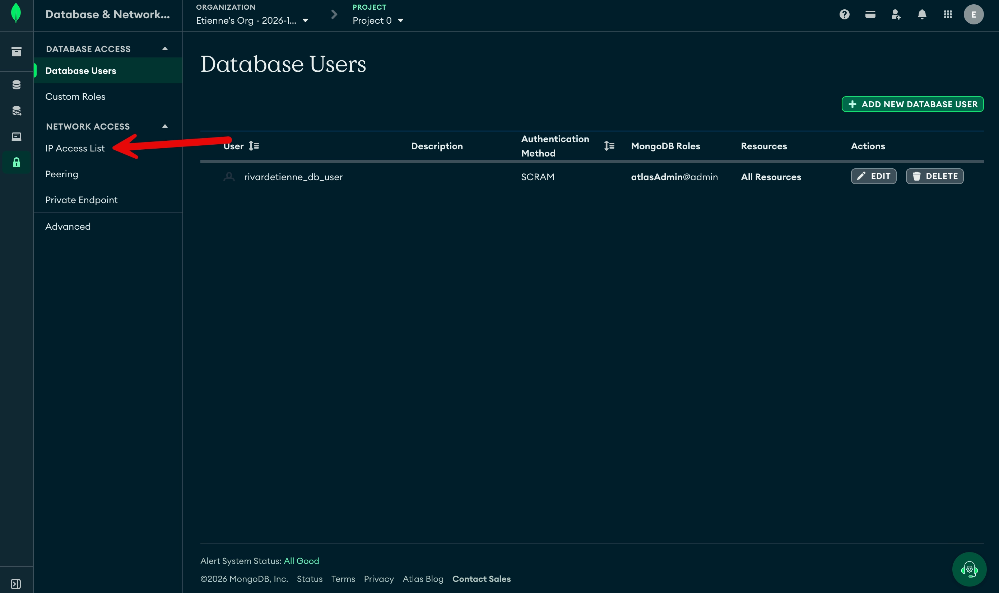
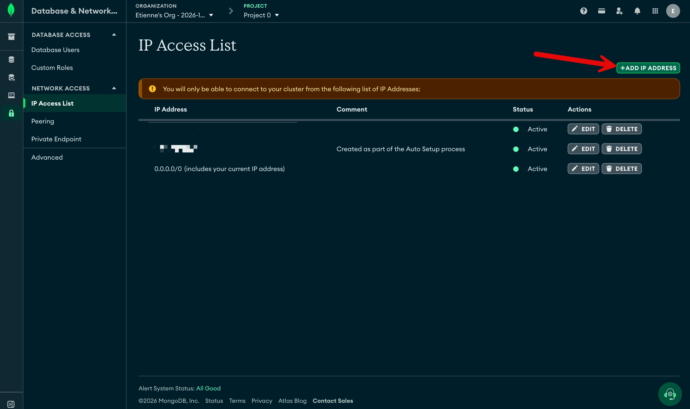
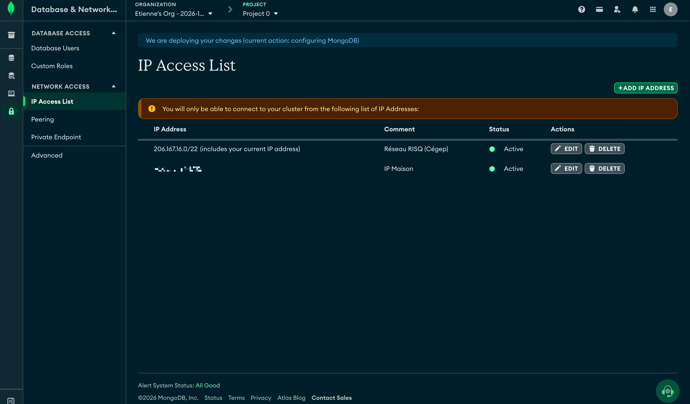
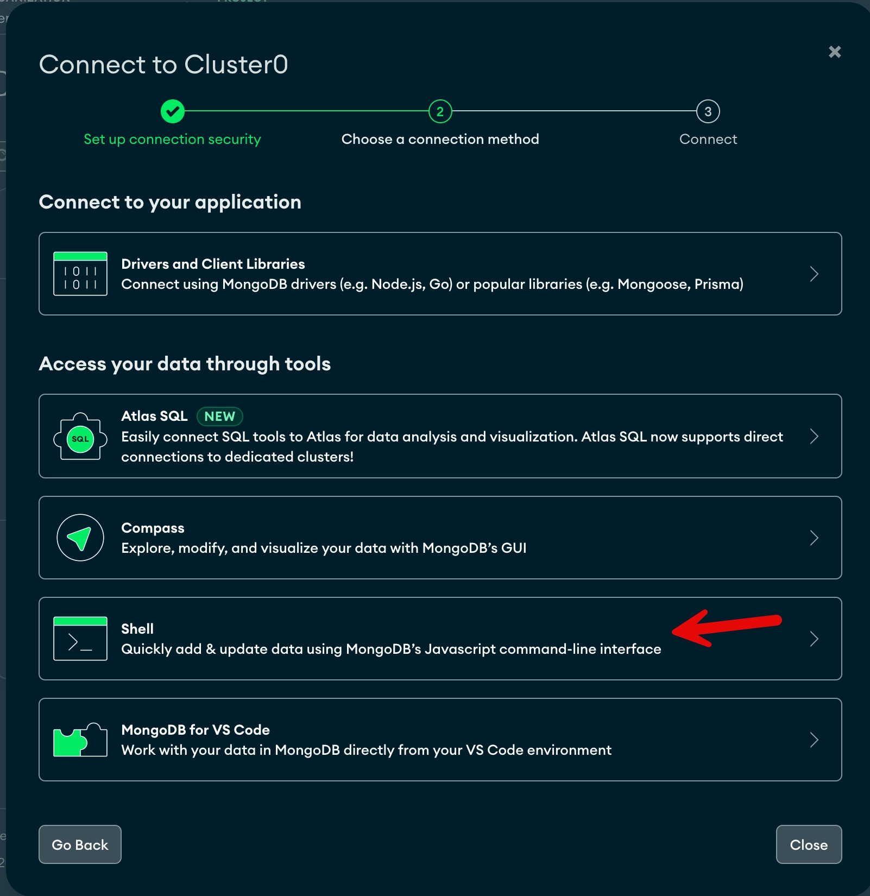
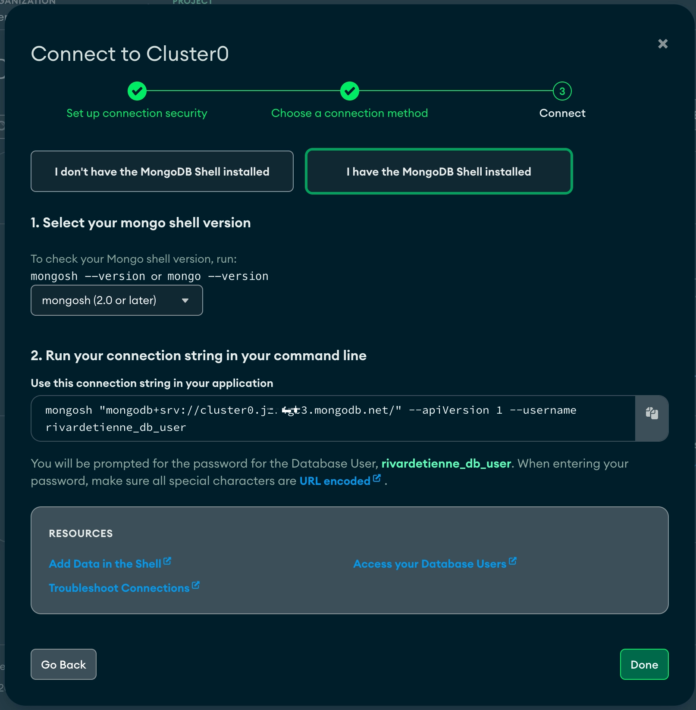

# Introduction à MongoDB

## MongoDB

- MongoDB est un SGBD orienté documents très utilisé en ce moment.
- Il est actuellement au top 5 des moteurs de bases de données, et la première place pour les SGBD NoSQL : 
    - <https://db-engines.com/en/ranking> (janvier 2026)
    - <https://db-engines.com/en/ranking_trend/system/MongoDB>
- La première version est sortie en 2009
- Mongo DB permet de manipuler des objets structurés au format BSON (JSON binaire)

## MongoDB – Installation locale

- Téléchargement et installation
    - <https://www.mongodb.com/try>
- Aide et documentation :
    - <https://docs.mongodb.com/manual/>
    - <https://docs.mongodb.com/manual/tutorial/>

## MongoDB Compass

MongoDBCompass est l’interface officielle pour MongoDB

### Désactiver l'intelligence artificielle de Compass  

  

## mongosh

**MongoDB Shell (`mongosh`)** est un outil ligne de commande (CLI) MongoDB permettant d’exécuter des commandes.

Il peut être utilisée pour manipuler les données et pour certaines opérations administratives.

L’interface est intégrée à *MongoDBCompass*. Elle est aussi disponible dans Devilbox dans le conteneur *mongodb*, et sous forme d’outil ligne de commande sous plusieurs systèmes d’exploitation, lien téléchargement:

[https://www.mongodb.com/docs/mongodb-shell/install/](https://www.mongodb.com/docs/mongodb-shell/install/)

### mongosh (suite)

`mongosh` est en fait l’interpréteur ligne de commande de NodeJS légèrement modifié:

- Javascript peut être utilisé
- Module d’accès à MongoDB rendu disponible automatiquement (`db.`)
- Commandes d’administration comme `use <bd>` et `show databases` ajoutées

Les scripts mongosh ont l’extension `.mongodb` ou `.mongodb.js`

## MongoDB for VS Code

Cette extension officielle de VS Code permet de:

- Se connecter à une base de données MongoDB
- D’explorer le contenu de la BD (db et collections)
- D’exécuter un script sous forme d’un fichier `.js` à l’aide d’une connexion à cette base de données.
- D’utiliser un IDE connu et profiter des autres extensions comme l’intégration git

L’extension introduit une notion de *Playground* qui est un fichier `.mongodb.js` dont le segment sélectionné va être exécuté à l’aide d’une connexion MongoDB. L’entièreté du fichier va être exécuté si rien n’est sélectionné. Très utile pour peaufiner une séquence complexe de commandes.

!!! note

    L’aperçu des réponses dans la fenêtre à droite n’affiche pas l’ensemble des résultats

Un exemple de script est généré à la création d’un nouveau Playground.

!!! warning "Attention"

    L’utilisation des outils d’IA sera interdite pendant les examens. Je vous recommande de désactiver Github Copilot ou toute autre aide IA intégrée à votre VS Code pendant les exercices du cours.

## Database tools

Depuis la version 4.4, les outils connexes à Mongo DB sont offerts séparément de l’installateur Mongo. Ces outils permettent entre autres l’importation et l’exportation de bases de données.

Ces outils sont tout de même intégrés dans l’outil *MongoDB Compass*. Si vous préférez ne pas installer *MongoDBCompass* ou utiliser le mode console pour administrer vos bases de données, vous devez installer ces outils.

Téléchargement et installation : [https://www.mongodb.com/try/download/database-tools ](https://www.mongodb.com/try/download/database-tools)*(package msi recommandé)*

Le chemin vers ces les outils n’est pas ajouté automatiquement au %PATH% sur Windows

## MongoDB Atlas – service infonuagique

«Assurez des performances et une faible latence avec MongoDB Atlas Database grâce à une mise à l’échelle intuitive, des ajustements automatisés des ressources et une distribution mondiale des données. Des outils intégrés **optimisent les requêtes** et **éliminent les inefficacités**, tandis que les **mises à niveau sans interruption** maintiennent la vitesse et la fiabilité»

- Service infonuagique: version Entreprise de MongoDB maintenue par MongoDB sur ses serveurs
- Version de base disponible gratuitement <https://www.mongodb.com/cloud/atlas>
- Les *nodes* dans Atlas sont les instances de mongodb, elles sont regroupées en *clusters* (grappes)

### Accès réseau

- Pour se connecter au serveur on doit donner accès à notre adresse IP :

### Sécurité

L’accès à votre instance de base de données sur Atlas est sécurisé sur la base de l’adresse IP du client. Initialement, Atlas offre d’ajouter votre l’adresse IP à la liste des adresses permises, selon ce qu’il détecte par votre connexion à l’interface web.

Au CÉGEP, ce n’est pas suffisant: l’accès à l’Internet est fait via le réseau RISQ, qui est le réseau des institutions d’études supérieures au Québec, et le trafic circule en utilisant divers chemins ce qui fait que l’adresse IP vue par Atlas peut changer d’une connexion à l’autre.

*Project → Security → Database & Network Access → Network Access → IP Access List*

***206.167.16.0/22*** - RISQ (capture d’écran prochaine page)

En cas de problème, vous pouvez tester avec 0.0.0.0/0 (accès permis pour tous les IP) – mais ne le laisser pas à cette valeur!

### Connexion

Pour se connecter, dans le GUI: *Clusters → Connect*

Choisir un type de connection, mais ce qui importe est le *Connection URI* (commence par *mongodb:* )

S’assurer d’avoir un utilisateur valide avec un mot de passe

## Exercice de connectivité

1. Connectez-vous à votre base de données locale (Devilbox)
    1. Via mongosh (exec dans le conteneur mongodb)
    1. À travers Compass puis le MongoDB Shell intégré
    1. À l’aide de l’extension VS Code pour MongoDB
1. Pour chaque connexion, insérer un document dans une nouvelle collection et faites afficher cette nouvelle collection dans les interfaces graphiques (Compass et VS Code)
1. Créez-vous un compte sur Atlas et insérer un document dans une nouvelle collection via l’interface web du service infonuagique
1. Connectez-vous à la base de données Atlas (assurez-vous d’autoriser votre adresse IP)
    1. Via mongosh (exec dans le conteneur mongodb)
    1. À travers Compass puis le MongoDB Shell intégré
    1. À l’aide de l’extension VS Code pour MongoDB