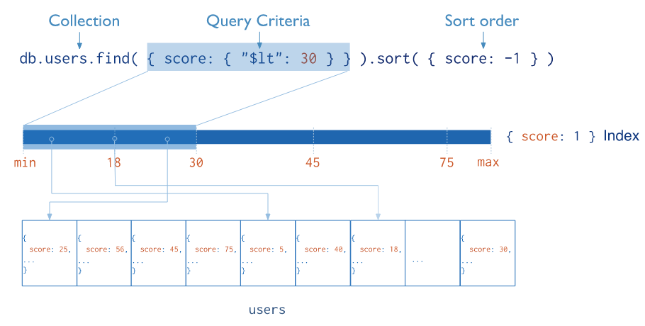
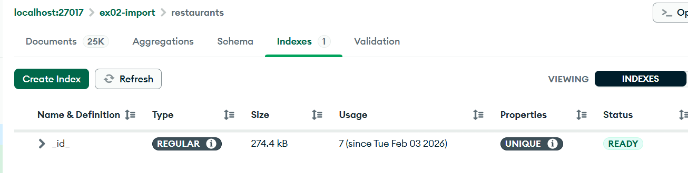
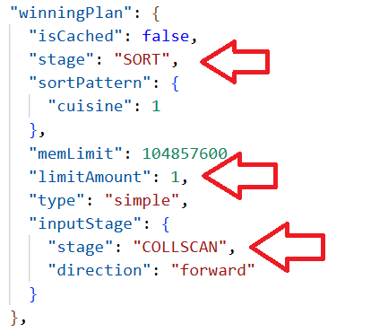
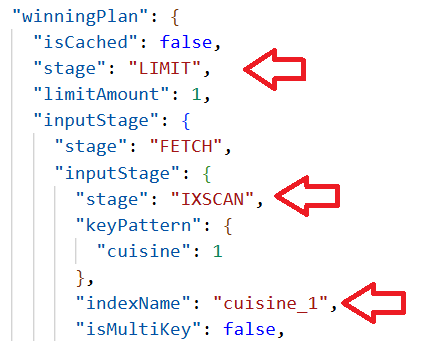
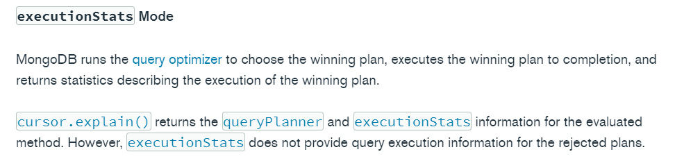
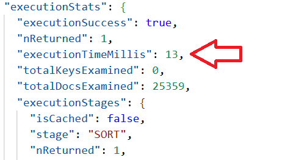

# MongoDB – Performances et index

## Exercice 1

Demandez à un agent conversationnel utilisant l'intelligence artificielle (Ex : ChatGPT)

- De vous expliquer le concept d’index dans une base de données.
- De vous donner deux exemples où il peut être intéressant d’ajouter un index
- La commande pour créer un index (MySQL et MongoDB)
- Demandez-lui finalement les autres moyens pour optimiser les performances d’une base de données
    - relationnelle (MySQL)
    - NoSQL (MongoDB)

## Les index

Les index représentent un moyen d’optimiser les performances de lecture dans une base de données.

Les index sous MongoDB:

<https://www.youtube.com/watch?v=U3iWPF5jP-g>

<https://docs.mongodb.com/manual/indexes/>

Performance de `aggregate()`: <https://youtu.be/BlPqPoyWk1k>



## L’index par défaut

Par défaut, les enregistrements sont automatiquement indexés par `_id`.

Onglet *Indexes* dans vue Collection de MongoDB Compass



## Choisir les index appropriés

- Prenez le temps d’analyser le type de requêtes que vous effectuez.
- Prendre le temps d’analyser :
    - les critères de recherche : `.find({ critères de recherche })`
    - les tris : `.sort({clé : 1})`
    - les regroupements (agrégations)

## Créer les index

**Syntaxe**

```javascript
db.<collection>.createIndex( {<clé>: <direction>}, <options> )
```

- `direction` :
    - `1` : ordre croissant
    - `-1` : ordre décroissant

**Exemples :**

```javascript
db.restaurants.createIndex( { name: 1 } )
db.restaurants.createIndex( { cuisine: 1, name: 1 } )
```

<https://docs.mongodb.com/manual/reference/method/db.collection.createIndex/>

MongoDB peut traverser les index en ordre inverse, donc c’est inutile de créer un index en ordre décroissant si le même index existe en ordre croissant

L’ordre décroissant est utile pour les index composés de plus d’un champ.

**Afficher les index existants :**

```javascript
db.<collection>.getIndexes()
```

## Vérifier la couverture des index

Syntaxe : `<cursor>.explain()`

**Exemples :**

```javascript
db.restaurants.find().explain()
db.restaurants.find({_id: ObjectId("5a9818171d769")}).explain()
db.restaurants.find().sort({cuisine : 1, name:1}).explain()
```

**Sources:**

- <https://docs.mongodb.com/manual/reference/method/cursor.explain/#mongodb-method-cursor.explain>
- <https://docs.mongodb.com/manual/tutorial/analyze-query-plan/>

Exemple collection *restaurants*

```javascript
db.restaurants.find().sort({ 'cuisine': 1 }).limit(1).explain();
```



Ajout d’un index sur *cuisine*

```javascript
db.restaurants.createIndex({ 'cuisine': 1 });
```



## Statistiques d’exécution

**Option :**

  

```javascript
db.restaurants.find().limit(1).explain('executionStats')
```




## Exercice 2 sur les requêtes

Base de données de `sample_airbnb` (Atlas) :

Lien direct (*Download raw file*): <https://github.com/neelabalan/mongodb-sample-dataset/blob/main/sample_airbnb/listingsAndReviews.json>

1. Affichez la liste des propriétés (`_id`, nom, type et nombre de lits) de type « House » pouvant accueillir (*accommodates*) plus de 5 personnes.
1. Affichez la liste des propriétés (nom et prix) entre 100$ et 150$
1. Affichez le nombre de propriétés, le prix minimum, maximum et moyen par type de propriété.
1. Regardez avec `.explain()` quels index peuvent être utilisés pour améliorer la performance pour les requêtes 1. 2. et 3.

## Exercice 3 sur les requêtes

Base de données de `sample_mflix` (`comments.json`) :

1. Affichez la liste des commentaires par film
1. Affichez le nombre de commentaires par film
1. Regardez avec `.explain()` quels index peuvent être utilisés pour améliorer la performance

<https://www.mongodb.com/docs/v4.2/reference/operator/aggregation/lookup/#examples>

Utiliser l’environnement *cloud* et charger le lot de données si ce n’est pas déjà fait : <https://www.mongodb.com/docs/atlas/import/load-sample-data/?interface=atlas-ui#std-label-load-sample-data>

Lien direct (*Download raw file*): <https://github.com/neelabalan/mongodb-sample-dataset/blob/main/sample_mflix/comments.json>
