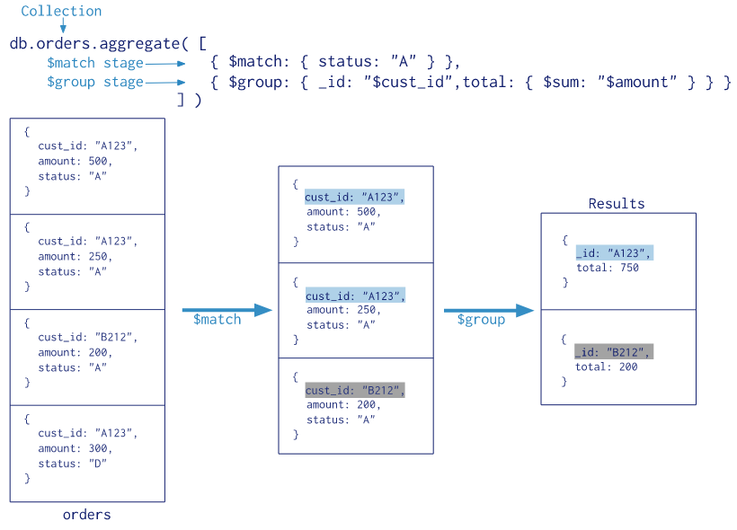

# MongoDB – Révision

## Retour sur les contenus couverts depuis le début de la session

- Introduction aux bases de données massives (mégadonnées)
    - 5V
    - Types de bases de données
    - Quel est le meilleur SGBD?
    - MongoDB
        - Insertion, édition, suppression, recherche
        - Tris, limite et sauts (skip)
        - Transformations et regroupements (aggregate)
        - Performances (Index)

## Les 5V des bases de données massives

- **Volume** : Quantité d’information à stocker
- **Variété** : Données complexes de formats différents
- **Vélocité** : Fréquence à laquelle les données sont générées, partagées et mises à jour
- Véracité : Fiabilité des données
- Valeur : Valeur des données

Les 3 premiers et plus importants sont appelés les **3V**

## Types de bases de données

- Relationnel (SQL)
    - Le modèle le plus utilisé actuellement
    - Utilise principalement les concepts de tables et de relations
- NoSQL / documents sans schéma
    - Introduit au début des années 2010
    - Développé à l’origine pour gérer du big data
- Orienté objet
- XML/documents structurés
- Graphes

## Quel est le meilleur SGBD?

- Tout est fonction des besoins!
- Relationnel
    - Connu des programmeurs
    - Mature et éprouvé
    - Approprié au transactionnel
- NoSQL / documents sans schéma
    - Bâti pour la mise à l’échelle
    - Plus facile d’utilisation

## MongoDB

- NoSQL, documents sans schéma
- Mise en place pour les mégadonnées
- Open-source
    - `mongod` : serveur
    - `mongos` : chef d’orchestre pour *sharding*
    - outils desktop
        - Compass
        - mongosh (CLI)
- Service infonuagique Atlas

## MongoDB - Insertion, édition, suppression, recherche

- **insertOne / insertMany**
- **updateOne / updateMany**
- **deleteOne / deleteMany**
- **find / aggregate**

## Tris, limite et sauts (skip)

- `sort()`
    - Un ou plusieurs critères (ET logique)
    - Sinon: ordre n’est pas défini (pas nécessairement l’ordre d’insertion)
- `limit()`
    - Utile suite à un `sort()` pour avoir le top N
- `skip(offset)`
    - Utile à la pagination

## Transformations et regroupements (aggregate)



## Agrégation: étapes

| Étape | Description |
|---|---|
| `$match` | Équivalent au `find`. Filtre les documents en fonction des critères spécifiés. |
| `$project` | Sélectionne / modifie les champs (ne modifie pas la quantité de documents) |
| `$group` | Regroupe les éléments identiques en fonction de l'expression (champ `_id`). Permet l'utilisation d'opérateurs d'accumulation (`$sum`, `$avg`, etc.) |
| `$sort` | Trie les documents en fonction des critères spécifiés. |
| `$limit` | Affiche les N premiers éléments. |
| `$skip` | Saute les N premiers éléments |
| `$count` | Retourne le nombre d'éléments par groupe |
| `$unwind` | Permet de déconstruire un tableau (un document par item) |

## Performances (Index)

- Index: table qui permet au SGBD de retrouver facilement les documents en fonction d’un champ (index par `_id` créé automatiquement)
- `<requête>.explain("executionStats")` pour avoir les temps d’exécution + savoir comment la requête a été exécutée

```javascript
db.collection.createIndex( { <champ>:<direction> } )
db.restaurants.createIndex( { cuisine: 1} )   // 1 pour ordre croissant
```

- Les index peuvent être composites, ie comporter plusieurs champs
    - Les champs d’un index sont consultés de gauche à droite
