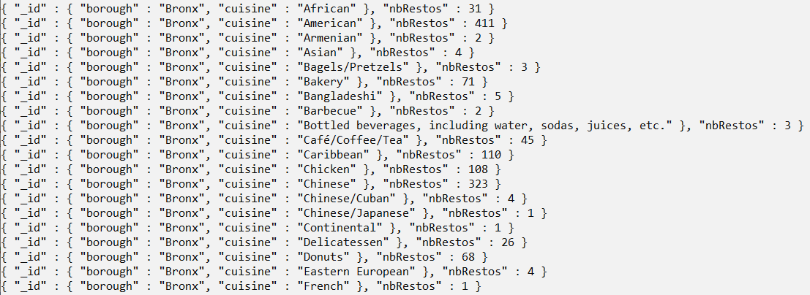
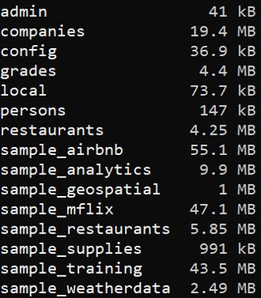

# MongoDB – Transformations

## `$arrayElemAt` (aggregation)

- Permet de sélectionner un élément dans un tableau :
    - <https://docs.mongodb.com/manual/reference/operator/aggregation/arrayElemAt/>
- Exemple :

```javascript
db.users.aggregate([
   {
     $project:
      {
         name: 1,
         first: { $arrayElemAt: [ "$favorites", 0 ] },  // 0: premier élément
         last: { $arrayElemAt: [ "$favorites", -1 ] }  // -1: dernier élément
      }
   }
])
```

Documents de la collection `users` :

```javascript
{ "_id" : 1, "name" : "dave123", favorites: [ "chocolate", "cake", "butter", "apples" ] }
{ "_id" : 2, "name" : "li", favorites: [ "apples", "pudding", "pie" ] }
{ "_id" : 3, "name" : "ahn", favorites: [ "pears", "pecans", "chocolate", "cherries" ] }
{ "_id" : 4, "name" : "ty", favorites: [ "ice cream" ] }
```

!!! example "Exercice"

    Trouvez le premier score de chaque restaurant.

## Équivalent du HAVING de MySQL

- Il est parfois nécessaire de filtrer les éléments groupés en fonction de la valeur obtenue par la fonction statistique (nombre, somme, moyenne).
- Exemple : <https://docs.mongodb.com/manual/reference/operator/aggregation/group/#group-by-item-having>

```javascript
db.sales.aggregate(
  [
    // Première étape
    {
      $group :
        { _id : "$item",
          totalSaleAmount: { $sum: { $multiply: [ "$price", "$quantity" ] } }}
     },
     // Deuxième étape
     {
       $match: { "totalSaleAmount": { $gte: 100 } }
     }
   ]
 )
```

## Regroupement de toutes les données

- Si l’on désire obtenir une fonction statistique (nombre, somme, moyenne, etc.) pour l’ensemble des données, il faut spécifier un `_id` constant
- La convention est d’utiliser `null`.
- Exemple : <https://docs.mongodb.com/manual/reference/operator/aggregation/group/#group-by-null>

```javascript
db.sales.aggregate([
  {
    $group : {
       _id : null,
       totalSaleAmount: { $sum: { $multiply: [ "$price", "$quantity" ] } },
       averageQuantity: { $avg: "$quantity" },
       count: { $sum: 1 }
    }
  }
])
```

## Regroupement par champs multiples

- On peut regrouper l’information à l’aide de plusieurs champs (index composite).
- Exemple : Nombre de restaurants par district (borough) et type de cuisine

```javascript
db.restaurants.aggregate([
	{
		$group:
		{
		  _id: {borough: "$borough", cuisine: "$cuisine"},
		  nbRestos: { $sum : 1}
		}
	},
	{
		$sort: {_id:1}
   }
])
```



## Requêtes pivot

- Il est également possible d’effectuer des analyses croisées (“pivot”).
- Exemple : <https://docs.mongodb.com/manual/reference/operator/aggregation/group/#pivot-data>

```javascript
db.books.aggregate([
   { $group : { _id : "$author", books: { $push: "$title" } } }
 ])
```

Documents de départ (collection `books`) :

```javascript
{ "_id" : 8751, "title" : "The Banquet", "author" : "Dante", "copies" : 2 },
{ "_id" : 8752, "title" : "Divine Comedy", "author" : "Dante", "copies" : 1 },
{ "_id" : 8645, "title" : "Eclogues", "author" : "Dante", "copies" : 2 },
{ "_id" : 7000, "title" : "The Odyssey", "author" : "Homer", "copies" : 10 },
{ "_id" : 7020, "title" : "Iliad", "author" : "Homer", "copies" : 10 }
```

Résultat :

```javascript
{ "_id" : "Homer", "books" : [ "The Odyssey", "Iliad" ] }
{ "_id" : "Dante", "books" : [ "The Banquet", "Divine Comedy", "Eclogues" ] }
```

- La requête nous a permis de “pivoter” de documents “livres” (*books*) vers des documents “auteurs” (*authors*)
- La même information est disponible, mais est maintenant centrée sur les auteurs
- `$group` avec un `$push` nous amène d’une relation Many-to-One vers un One-To-Many
- L’opérateur `$unwind` permet l’opération contraire :

```javascript
.aggregate([ { $unwind: "$books" }, { $project: { author: "$_id", title: "$books"} } ])
```

## Tutoriels de MongoDB sur `aggregate()`

- `$group` et fonctions statistiques
    - <https://www.mongodb.com/docs/manual/tutorial/aggregation-examples/group-and-total/>
- `$unwind` suivi de `$group`
    - <https://www.mongodb.com/docs/manual/tutorial/aggregation-examples/unpack-arrays/>

## Échantillons de données

- Voici d’autres échantillons de données fournis par MongoDB que nous utiliserons dans les prochaines semaines :
    - `sample_airbnb`
    - `sample_mflix`

Pour accéder aux données :

Utiliser l’environnement cloud et charger le lot de données : <https://www.mongodb.com/docs/guides/atlas/sample-data/>



## MongoDB University

- MongoDB University est une plateforme en ligne permettant d’apprendre de solides bases sur ce SGBD.
- Nous suivrons partiellement cette formation: <https://learn.mongodb.com/courses/mongodb-aggregation>
