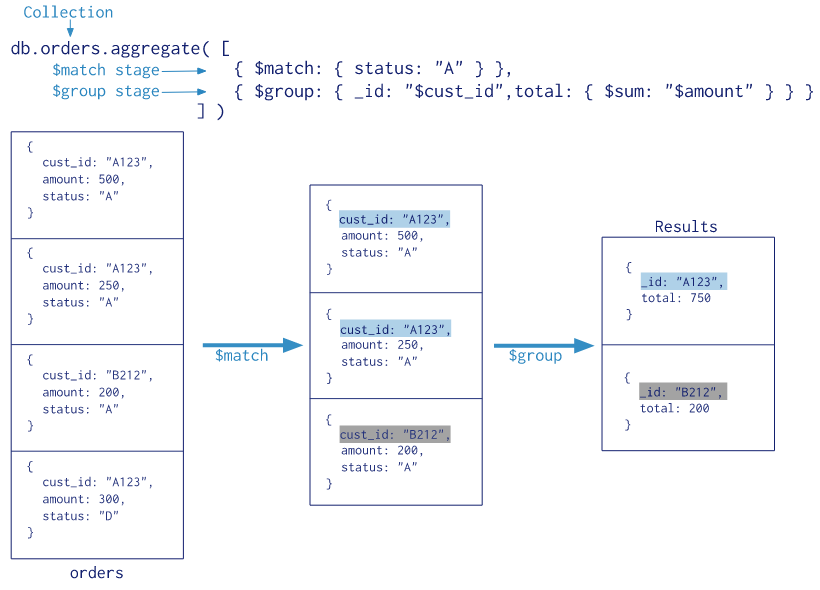
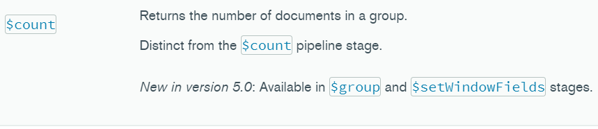
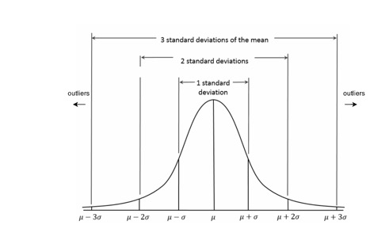

# MongoDB – Tri, limites et regroupement

## Les tris

La commande `sort` permet de trier les données issues de la requête.

Syntaxe :

```javascript
db.collection.find().sort( { clé1: indice_tri, clé2: indice_tri, …, cléN: indice_tri } )
```

- clé : nom du champ à trier
- indice tri : **1** pour trier en ordre **croissant**, **-1** pour trier en ordre **décroissant**.

**Exemples :**

```javascript
db.restaurants.find({}, {_id:0, name:1}).sort({name:1})
db.restaurants.find({}, {_id:0, cuisine : 1, name:1}).sort({cuisine : 1, name:1})
db.restaurants.find({}, {_id:0, cuisine : 1, name:1, address:1}).sort({'address.zipcode':-1})
```

Documentation officielle: <https://docs.mongodb.com/manual/reference/method/cursor.sort/>

## Les limites

La commande `limit` permet de préciser le nombre d’enregistrements retournés par la requête, pour en limiter la quantité.

Dans la plupart des cas, il est essentiel d’appliquer préalablement un tri.

**Exemple :**

```javascript
db.restaurants.find({}, {_id:0, name:1}).sort({name:1}).limit(5)
```

Documentation officielle : <https://docs.mongodb.com/manual/reference/method/cursor.limit/>

## Les transformations (aggregations)

Fonctionnalité intégrée à MongoDB permettant essentiellement de regrouper, de manipuler, de transformer les données et/ou d’effectuer des calculs statistiques.

Syntaxe :

```javascript
db.collection.aggregate(pipeline, options)
```

**Pipeline** : Un **tableau** contenant les étapes de regroupement (voir plus bas)

Documentation officielle :

- <https://docs.mongodb.com/manual/core/aggregation-pipeline/>
- <https://docs.mongodb.com/manual/reference/method/db.collection.aggregate/#db.collection.aggregate>

Explication vidéo : <https://youtu.be/Kxegt-5iT-Q>

## Les étapes de transformations (aggregations)

Le premier argument de la méthode [db.collection.aggregate](https://docs.mongodb.com/manual/reference/method/db.collection.aggregate/#db.collection.aggregate) est un **tableau d’étapes** de transformations.

Les possibilités sont très variées. Voici les mots-clés les plus fréquemment utilisés :

| Étape | Description |
|---|---|
| `$match` | Équivalent au `find`. Filtre les documents en fonction des critères spécifiés. |
| `$group` | Regroupe les éléments identiques en fonction de l'expression. Permet aussi l'utilisation de fonctions statistiques (somme, moyenne, min, max, etc.) |
| `$sort` | Trie les documents en fonction des critères spécifiés. |
| `$limit` | Affiche les N premiers éléments. |
| `$skip` | Saute les N premiers éléments (comme `offset()`). |
| `$count` | Retourne le nombre d'éléments correspondant aux critères spécifiés. |
| `$unwind` | Est aussi approprié dans certains contextes. Il permet de déconstruire un tableau (plus d'info plus tard). |

## Exemple de référence



## Exemples supplémentaires

```javascript
db.restaurants.aggregate([
    {
        $match : {cuisine:"Salads"}
    }
])
```

Équivalent à :

```javascript
db.restaurants.find({cuisine:"Salads"})
```

Regroupement par cuisine :

```javascript
db.restaurants.aggregate([
    {
        $group: {
            _id: "$cuisine",
        }
    }
])
```

L’opérateur `$count` est souvent utilisé dans l'étape de regroupement (`$group`) :

```javascript
db.restaurants.aggregate([
    {
        $group: {
            _id: "$cuisine",
            nbRestos: { $count: {} }
        }
    }
])
```

[Liste des opérateurs d’accumulation disponibles avec `$group`](https://www.mongodb.com/docs/manual/reference/operator/aggregation/group/#std-label-accumulators-group)



## Utiliser des scripts dans mongosh

Comme nos instructions MongoDB sont de plus en plus complexes, nous pouvons les éditer dans un fichier et les exécuter à l’aide de `mongosh`

**Dans mongosh même:**

```javascript
load( "scripts/monscript.js" )
```

**Dans une ligne de commande Windows:**

```bash
mongosh --file scripts/monscript.js
```

Documentation : <https://www.mongodb.com/docs/mongodb-shell/write-scripts/>

## Exercice 3

**Restaurants :**

- Liste des restaurants (nom seulement) triée en ordre décroissant de nom.
- Nombre de restaurants par arrondissement (borough)
- Nombre de restaurants par cuisine
- **Avancé**: Nombre d’évaluations (grades) par restaurant (indice : utiliser [\$unwind](https://docs.mongodb.com/manual/reference/operator/aggregation/unwind/) ou [\$size](https://docs.mongodb.com/manual/reference/operator/aggregation/size/))

**Personnes**

- Liste des 5 premières personnes de la collection
- Liste des 5 premières personnes de la collection ayant les yeux bleus
- Liste des 5 premières personnes de la collection (triée par nom) ayant les yeux bleus
- Nombre de personnes selon la couleur des yeux
- **Avancé :** Moyenne du nombre d’amis selon la couleur des yeux
- **Avancé :** Nombre de personnes par groupe d’âge (tranches de 10 ans)

**Résultats (grades)**

- Liste des 10 meilleurs résultats à l’examen
- Moyenne par élève
- Moyenne par type d’évaluation
- **Avancé** : Écart type (*standard deviation*) par évaluation

L’écart type est une mesure permettant de mesurer la dispersion autour de la moyenne. Elle est entre autres utilisée dans les Mégadonnées pour détecter les valeurs aberrantes (*outliers*) qui peuvent provenir d’erreurs de saisie. (<https://www.mongodb.com/docs/manual/reference/operator/aggregation/stdDevSamp/>)

<https://medium.com/@dhwajraj/learning-python-regression-analysis-part-7-handling-outliers-in-data-d36ee9e2130b>


