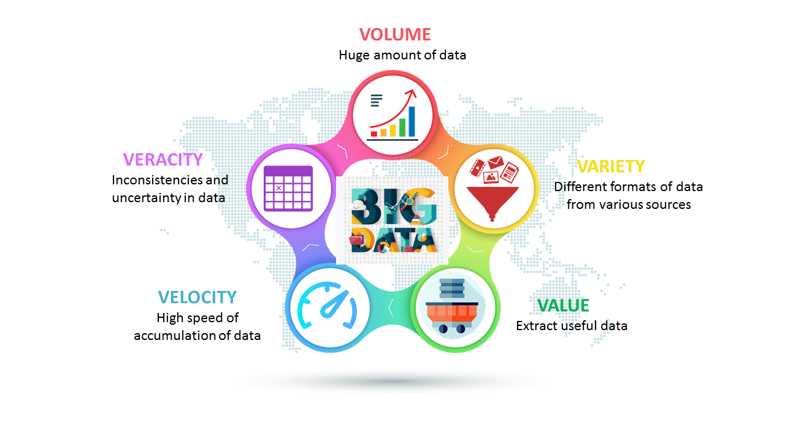
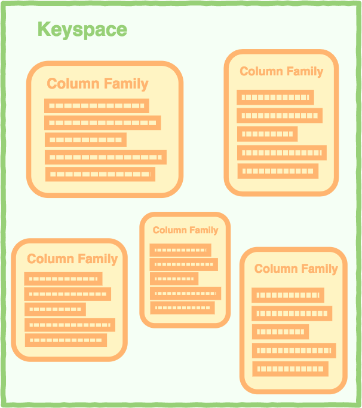
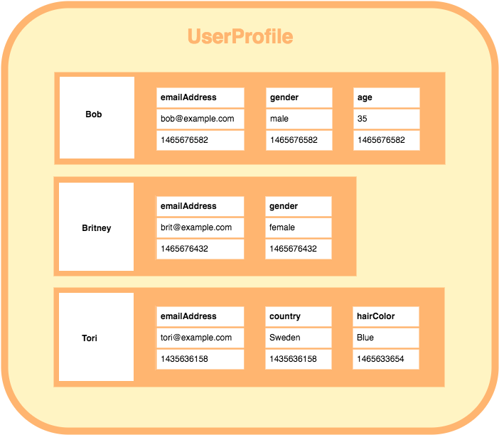
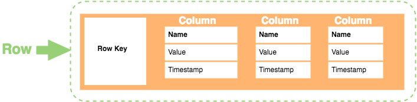
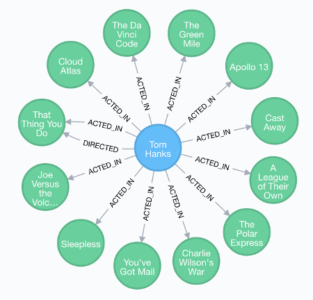
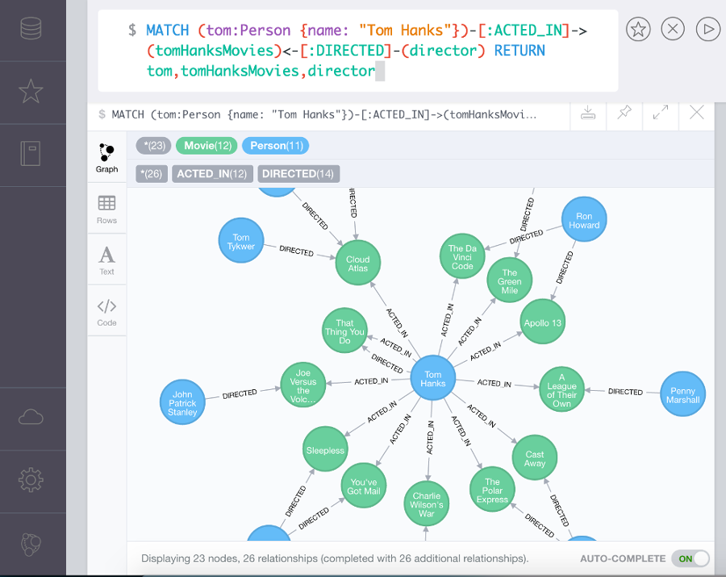

# Les bases de données NoSQL

## Quels sont les différents modèles de bases de données ?

- Hiérarchique
    - Les informations sont stockées dans une structure arborescente
- Réseau
    - Semblable au modèle hiérarchique, mais offre une flexibilité dans la façon de relier l’information
- Relationnel
    - Le modèle le plus utilisé actuellement
    - Utilise principalement les concepts de tables et de relations
- Orientée objet
    - Les informations sont stockées dans un modèle objet
- Orientée documents
    - Les informations sont stockées sous forme de documents
- XML
    - Les informations sont stockées dans un modèle XML
- NoSQL
    - Introduit au début des années 2010
    - Développé à l’origine pour gérer du big data

## NoSQL

- Famille de [systèmes de gestion de base de données](https://fr.wikipedia.org/wiki/Syst%C3%A8me_de_gestion_de_base_de_donn%C3%A9es) (SGBD)
- Non fondé sur l’architecture classique des [bases relationnelles](https://fr.wikipedia.org/wiki/SGBDR).
- Apparition au début des années 2010
- Développé à l’origine pour gérer du big data
- **Objectif :** Offrir des bases de données performantes et flexibles requises pour les applications modernes.

**Références :**

- BRUCHEZ Rudi. *Les bases de données NoSQL et le Big Data*
- NoSQL for dummies : <https://books.google.fr/books?id=O_UwBgAAQBAJ&lpg=PA101&dq=nosql&hl=fr&pg=PA101#v=onepage&q=nosql&f=false>
- Getting started with NoSQL : <https://books.google.fr/books?id=oPiT-V2eYTsC&lpg=PA1&dq=nosql&hl=fr&pg=PA1#v=onepage&q=nosql&f=false>
- Wikipedia : <https://fr.wikipedia.org/wiki/NoSQL>
- <https://www.grafikart.fr/blog/sql-nosql>

## Big Data

- Le terme big data fait référence à des données massives (mégadonnées).
- Désigne des ensembles de données qui deviennent tellement volumineux qu’il est difficile de les manipuler avec des outils classiques de gestion de base de données.
- Il n’y a pas de taille prédéfinie, et dépend de l’organisation.
- Le big data d’une petite entreprise sera nécessairement différente du big data d’une multinationale.
- Les 3V / 5V du big data :
    - **Volume** : Quantité d’information à stocker
    - **Variété** : Données complexes de formats différents
    - **Vélocité** : Fréquence à laquelle les données sont générées, partagées et mises à jour
    - Véracité : Fiabilité des données
    - Valeur : Valeur des données



## Big Data / Mégadonnées

- Applications :
    - Commerce électronique
    - Médias sociaux
    - Recherche scientifique
    - Politique
    - Secteur énergétique
    - **en bref, TOUS les secteurs!**
- Sources :
    - <https://fr.wikipedia.org/wiki/Big_data>
    - <http://database.guide/what-is-big-data/>

## Catégories de NoSQL

- Clé / valeur (Key-value stores)
- Colonnes (Wide-column stores)
- Document (Document Databses)
- Graphe (Graph and Triple Stores)

Sources :

- <https://www.mongodb.com/scale/types-of-nosql-databases>
- <http://database.guide/nosql-database-types/>
- NoSQL for Dummies : <https://books.google.fr/books?id=O_UwBgAAQBAJ&lpg=PA101&dq=nosql&hl=fr&pg=PP1#v=onepage&q&f=false>

## Clé / valeur (Key-value stores)

Chaque item de la base de données possède un nom (la clé) auquel est associé une valeur.

- La clé est unique et peut être n’importe quoi (nombre ou texte)
- Par souci de performance, il faut éviter d’avoir une clé trop longue. Certains SGBD limitent la clé à 512 MB
- La valeur peut être n’importe quoi (nombre, texte, image, etc.) La valeur peut être une liste ou encapsuler une autre combinaison clé-valeur.

**Exemples :**

| Routage |  |
|---|---|
| **Clé** | **Valeur** |
| 202.45.12.34 | `01:23:36:0f:a2:33` |
| 202.45.12.4 | `0:15:13:da:1c:11` |
| 245.12.33.45 | `02:a3:11:10:e1:b1` |
| 101.234.55.1 | `b8:67:a3:11:23:b1` |
| ... | ... |

| Bottin |  |
|---|---|
| **Clé** | **Valeur** |
| Bob | (123) 456-7890 |
| Joe | (234) 547-8901 |
| Bill | (345) 678-9012 |
| Jane | (456) 789-0123 |
| ... | ... |

| Artistes |  |
|---|---|
| **Clé** | **Valeur** |
| `artiste:1:nom` | Bring Me The Horizon |
| `artiste:1:genre` | Metal |
| `artiste:2:nom` | Bad Omen |
| `artiste:2:genre` | Metal |
| ... | ... |

| Produits |  |
|---|---|
| **Clé** | **Valeur** |
| 12345 | A, 100, 85.50 |
| 23456 | B, 50, 18.00 |
| 34567 | C, 78, 60.25 |
| 45678 | D, 250, 2.5 |
| ... | ... |

**Exemples de contextes d’utilisation :**

- Web :
    - Profils utilisateurs, informations sur une session, cookies
    - Articles / blog, courriels, messages
    - Cache de pages web
- Commerce électronique
    - Panier d’achat
    - Gestion de produits (catégories, détails, commentaires)
- Réseau
    - Tables de routages
    - Réplication

Sources : <http://database.guide/what-is-a-key-value-database/>

**SGBD qui intègrent l’approche clé-valeur**

- [Redis](https://redis.io/)
- [Oracle NoSQL](https://www.oracle.com/database/nosql/index.html)
- [Aerospike](http://www.aerospike.com/)
- [Oracle Berkeley DB](http://www.oracle.com/technetwork/database/database-technologies/berkeleydb/overview/index.html)

Sources : <http://database.guide/what-is-a-key-value-database/>

## Colonnes (Wide-column stores)

- Base de données qui utilise le modèle “orienté colonnes”
- Bien que ce modèle soit considéré comme une base de données NoSQL, ils utilisent également certains concepts associés aux bases de données relationnelles.
- Le concept “keyspace” : s’apparente au schéma relationnel :

Sources : [http://database.guide/what-is-a-column-store-database/ ](http://database.guide/what-is-a-column-store-database/)<http://www.ingenioussql.com/2013/02/28/rules-of-engagement-nosql-column-data-stores/>

Une colonne “famille” contient plusieurs lignes

Chaque ligne peut contenir un nombre différent de colonnes, les types ne doivent pas nécessairement correspondre.

Chaque colonne contient une paire clé/valeur et un timestamp.







**Avantages associés à ce type de BD :**

- Cette approche facilite la compression de l’information
- La semi-structure facilite l’utilisation de fonctions statistiques (somme, compte, moyenne, etc.)
- Très flexible
- Rapide pour le chargement et les requêtes.

**Quand devrait-on utiliser ce type de BD?** <http://hbase.apache.org/book.html#arch.overview.when>

Sources : <http://database.guide/what-is-a-column-store-database/>

**SGBD qui intègrent cette approche**

- [Bigtable (Google)](https://cloud.google.com/bigtable/)
- [Cassandra](http://cassandra.apache.org/)
- [HBase (Apache)](https://hbase.apache.org/)
- [Druid](http://druid.io/)
- [Accumulo](https://accumulo.apache.org/)

Sources : <http://database.guide/what-is-a-column-store-database/>

## Document (Document Databases)

- Base de données qui utilise le modèle “orienté documents”
- Les informations sont stockées dans un seul document.
- Chaque document contient une **semi-structure** qui permet d’analyser et rechercher les données présentes dans le document.

**Exemples**

=== "JSON"

    ```json
    {
      '_id' : 1,
      'artistName' : { 'Bring Me The Horizon' },
      'albums' : [
        { 'albumname' : 'Amo', 'datereleased' : 2019, 'genre' : 'Metal' },
        { 'albumname' : 'Post Human: Nex Gen', 'datereleased' : 2024, 'genre' : 'Metal' }
      ]
    }
    ```

=== "XML"

    ```xml
    <artist>
      <artistname>Bring Me The Horizon</artistname>
      <albums>
        <album>
          <albumname>Amo</albumname>
          <genre>Metal</genre>
        </album>
        <album>
          <albumname>Post Human: Nex Gen</albumname>
          <genre>Metal</genre>
        </album>
      </albums>
    </artist>
    ```

**Exemples de contextes d’utilisation :**

- Création d’API (XML, JSON, YAML, BSON, etc.)
- Applications web
    - CMS, Blogs
    - Commerce électronique
    - “Web analytics”
- Contenu entre utilisateurs
    - Chats, Tweets, Posts, Ratings, commentaires, etc.
- Catalogues
    - Comptes utilisateurs
    - Catalogue de produits
- Jeux
    - Gestion des statistiques, scores
    - Chats
- Objets connectés

Sources : [http://database.guide/what-is-a-document-store-database/ ](http://database.guide/what-is-a-document-store-database/)

**SGBD qui intègrent cette approche**

- [MongoDB](https://www.mongodb.com/)
- [DocumentDB](https://azure.microsoft.com/en-us/services/documentdb/) (Microsoft)
- [CouchDB](http://couchdb.apache.org/) (Apache)
- [MarkLogic](http://www.marklogic.com/)

Sources : <http://database.guide/what-is-a-document-store-database/>

## Graphe (Graph and Triple Stores)

- Cette méthode représente l’information sous forme de graphe :
    - Les cercles correspondent aux nœuds
    - Les flèches correspondent aux relations entre les nœuds.
- C’est un excellent choix lorsque beaucoup de données sont interreliées.
- Exemples:
    - <http://my-neo4j-movies-app.herokuapp.com/>
    - <https://neo4j.com/graphgist/graph-of-the-free-agent-players-of-major-league-baseball-2016>
    - <https://neo4j.com/graphgists/>
- Les bases de données en graphes étant structurées, il est possible d’utiliser un langage de requêtes. Plusieurs langages sont possibles (Cypher, Javascript, JSON, etc.)

    ```cypher
    MATCH (tom:Person {name: "Tom Hanks"})-[:ACTED_IN]->(tomHanksMovies) RETURN tom,tomHanksMovies
    ```

- Sources : <http://database.guide/what-is-a-graph-database/>



**Voici un second exemple de graphe qui ajoute les directeurs au graphe précédent :**



**Bénéfices :**

- Meilleures performances lors des larges requêtes impliquant de multiples relations ou les requêtes récursives.
- L’absence de diagramme propose plus de flexibilité lorsque le modèle évolue.
- En étant plus flexibles, le développement et la maintenance des applications sera plus efficaces dans une pratique itérative (méthode agile)

**Exemples de contextes d’utilisation :**

- Réseaux sociaux
- Diagrammes réseaux
- Recommandations de produits en temps réel

**SGBD qui intègrent cette approche**

- [Neo4j](https://neo4j.com/product/)
- [Blazegraph](https://www.blazegraph.com/)

Sources : <http://database.guide/what-is-a-graph-database/>

## À retenir

- Il existe plusieurs moyens de structurer des données
- Aucune des méthodes n’est meilleure que les autres
    - Chaque modèle a ses **avantages**
    - Chaque modèle a ses **désavantages**
- Pouvez-vous me nommer :
    - Un avantage et un désavantage de chacun des modèles suivants :
        - Relationnel
        - Colonnes
        - Document
        - Graphe
